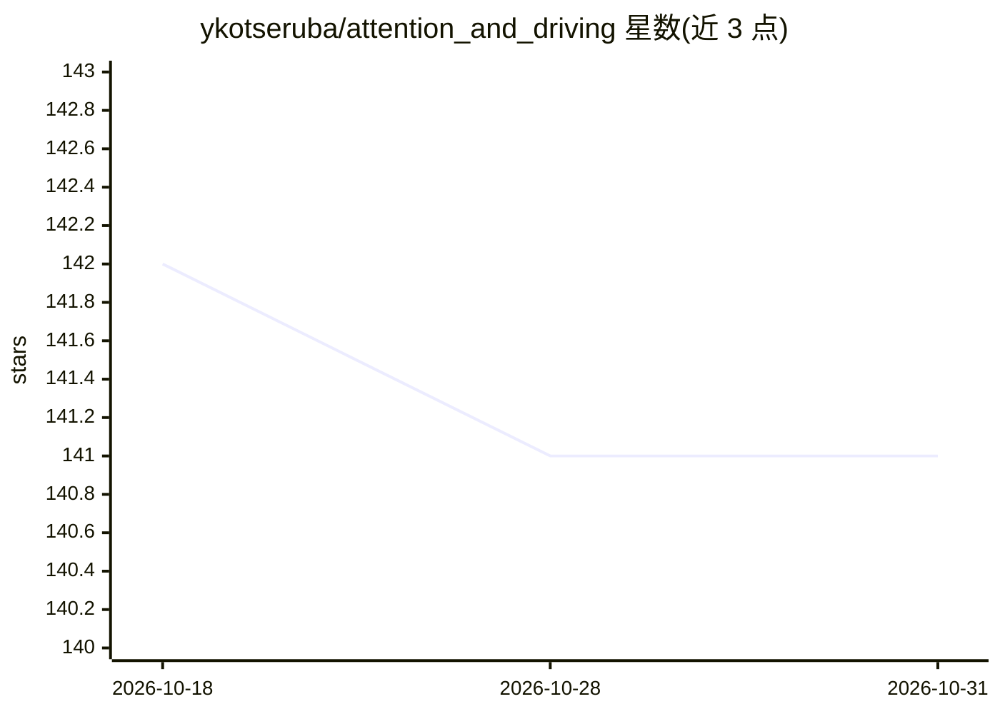

# ykotseruba/attention_and_driving

⭐ 141 · 推送 2025-12-10 · [GitHub](https://github.com/ykotseruba/attention_and_driving) · [官网](https://ieeexplore.ieee.org/document/9827989) · 个人维护

**驾驶员注意力领域同行评审论文策展清单**

收录 2010 年以来发表于交通、人因与机器人领域顶级会议/期刊的驾驶员注意力相关同行评审论文，配套综述论文与报告使用。条目分三组：行为研究（心理学的注意力研究）、应用研究（按场景注视预测、车内注视检测、分心检测、疲劳检测、动作预测等类别组织，附代码链接与所用数据集信息）以及数据集（附数据与标注摘要）。收录排除非汽车交通方式、仅间接测量注意力的研究及非同行评审论文（政府机构报告除外）。每条提供论文链接、bibtex 引用与标签。

## 筛选速览

| 维度 | 判定 | 备注 |
|---|---|---|
| AI 角色 | `ai-knowledge` | 知识聚合/清单类 |
| 许可风险 | `none` | — |
| 部署形态 | `None` |  |
| 模型依赖 | — | README 未给出锁定关系 |
| 硬件要求 | — | 无带数字的原话,不猜 |
| 安装摩擦 | `low` | 无编译、无系统依赖或容器化 |
| 成熟度 | — | 结构信号不足 |

## 能力要点

- 论文按行为研究、应用（多类别）与数据集三组组织
- 应用论文附代码链接与所用数据集（公开/私有）信息
- 数据集条目附数据链接、标注摘要与 bibtex 引用

## 适用场景

- 查找驾驶员注意力/注视/分心/疲劳方向的研究论文
- 寻找带公开代码的注意力建模或检测方法
- 为辅助与自动驾驶研究选取带注意力标注的数据集

## 场景标签

`精选清单` · 领域:学习与行业

## 证据(README 行号)

> L3: This is a curated collection of peer-reviewed papers related to attention and driving published in top transportatio
> L15: Papers in the collection are grouped into behavioral, application (grouped into 5 categories), and datasets. For ea

## 星数曲线

2026-10-18 142 → 2026-10-31 141（-1）

---
*卡片 v1 · prompt 1.4 · 生成 2026-10-22 · 置信度 high · 依据 README sha `9d21840db2cf` · [字段定义](../../DATASET.md)*
