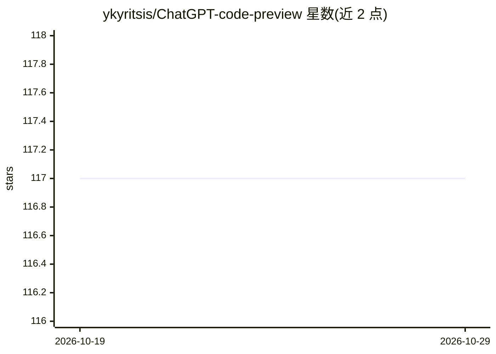

# ykyritsis/ChatGPT-code-preview

⭐ 117 · JavaScript · MIT · 推送 2026-10-19 · [GitHub](https://github.com/ykyritsis/ChatGPT-code-preview) · 个人维护

**在 ChatGPT 页面内实时预览代码块的 Chrome 扩展**

Manifest V3 的 Chrome 扩展：用 MutationObserver 监听 ChatGPT 对话中的新代码块，在回复旁注入可拖拽调整大小的预览面板，将 HTML/CSS/JavaScript 写入同页 iframe 实时渲染，并提供 Preview/Code 切换、复制与按扩展名下载。整个扩展仅为 manifest.json、content.js 与 styles.css，无构建步骤、无后台服务、无网络代码。README 明确说明这是 2024 年 7 月的快照实现，ChatGPT DOM 变化后可能需要更新选择器，不承诺长期兼容。

## 筛选速览

| 维度 | 判定 | 备注 |
|---|---|---|
| AI 角色 | `ai-ecosystem` | LLM/agent 周边工具 |
| 许可风险 | `permissive` | MIT |
| 部署形态 | `None` |  |
| 模型依赖 | — | README 未给出锁定关系 |
| 硬件要求 | — | 无带数字的原话,不猜 |
| 安装摩擦 | `low` | 无编译、无系统依赖或容器化 |
| 成熟度 | — | 结构信号不足 |

## 能力要点

- MutationObserver 监听 DOM，自动为代码块注入预览面板
- HTML/CSS/JS 在同页 iframe 中实时渲染，面板可拖拽调整
- 无构建步骤、无后台服务、无网络代码，仅需 activeTab 权限
- 终端类无视觉输出的代码块自动隐藏预览按钮

## 适用场景

- 在 ChatGPT 中直接查看生成的网页布局、图表或交互组件
- 不离开对话页面即可切换查看渲染结果与源码
- 复制或按正确扩展名下载生成的代码片段

## 场景标签

 · 领域:开发者工具/浏览器扩展

## 证据(README 行号)

> L6: A Chrome extension that turns HTML, CSS and JavaScript code blocks into resizable live previews, right beside the re
> L53: A `MutationObserver` watches the conversation for new code blocks. For each one, the content script injects a small

## 星数曲线

2026-10-19 117 → 2026-10-29 117（+0）

---
*卡片 v1 · prompt 1.4 · 生成 2026-10-23 · 置信度 high · 依据 README sha `cff40b72c6cd` · [字段定义](../../DATASET.md)*
