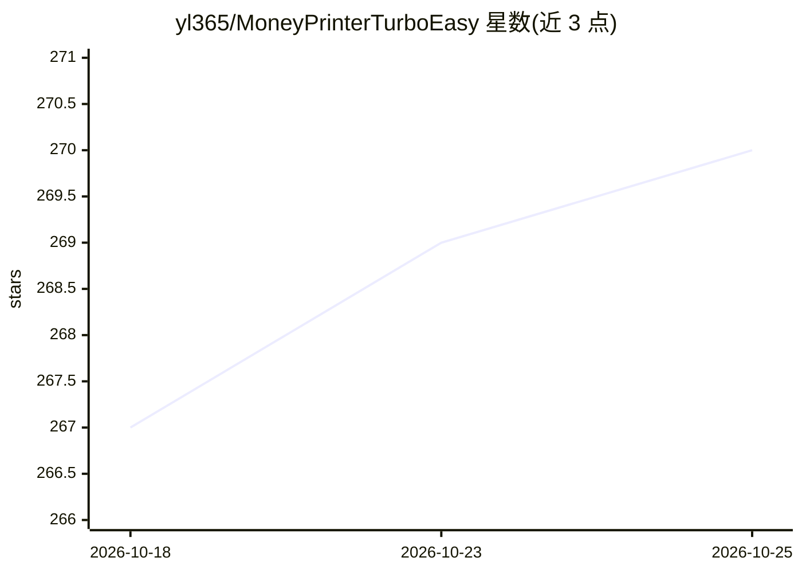

# yl365/MoneyPrinterTurboEasy

⭐ 271 · QMake · 推送 2026-07-10 · [GitHub](https://github.com/yl365/MoneyPrinterTurboEasy) · 个人维护 · 中文 README

**一句话主题词生成带配音短视频的 Windows 绿色版工具**

基于 MoneyPrinter/MoneyPrinterTurbo 的再分发版本（自称“完美复刻”）：输入主题词后调用 OpenAI 兼容 API（README 推荐 qwen 系列）生成文案，从 Pexels/Pixabay 按 API Key 获取素材，自动匹配合成带语音的高清短视频，可调语速、音色与横竖屏。以 Windows 绿色版 exe 分发（百度网盘/夸克网盘下载），改 config.toml 后双击运行，无需安装；依赖用户自备 LLM API Key 与素材站 Key，支持配置代理。

## 筛选速览

| 维度 | 判定 | 备注 |
|---|---|---|
| AI 角色 | `ai-native` | 本体是模型或模型工具 |
| 许可风险 | `none` | — |
| 部署形态 | `desktop` | 安装包/桌面程序 |
| 模型依赖 | — | README 未给出锁定关系 |
| 硬件要求 | — | 无带数字的原话,不猜 |
| 安装摩擦 | `low` | 无编译、无系统依赖或容器化 |
| 成熟度 | — | 结构信号不足 |

## 能力要点

- 主题词→AI 文案→素材匹配→配音合成全流程自动化
- Windows 绿色版，改 config.toml 后双击 ai_video.exe 运行
- 兼容 OpenAI 协议 API，README 推荐 qwen 系列
- 内置共享 Pexels/Pixabay ApiKey，可替换为独立 Key 并支持代理

## 适用场景

- 我想输入一个主题就出一条带配音的短视频
- 批量产出营销/种草类短视频内容
- 不会拍摄剪辑，用 AI 生成可发布的视频素材

## 场景标签

`AI 写作` `语音合成` · 领域:内容生成

## 证据(README 行号)

> L16: 输入主题词（如“如何赚钱？”、“美妆护肤攻略”），系统自动输出完整文案框架，搭配真人语音与高清画面，从0到成品仅需3分钟！
> L35: 1️⃣ **用AI创作文案**

## 星数曲线

2026-10-18 267 → 2026-10-25 270（+3）

---
*卡片 v1 · prompt 1.4 · 生成 2026-10-22 · 置信度 high · 依据 README sha `8f668e8195c4` · [字段定义](../../DATASET.md)*
