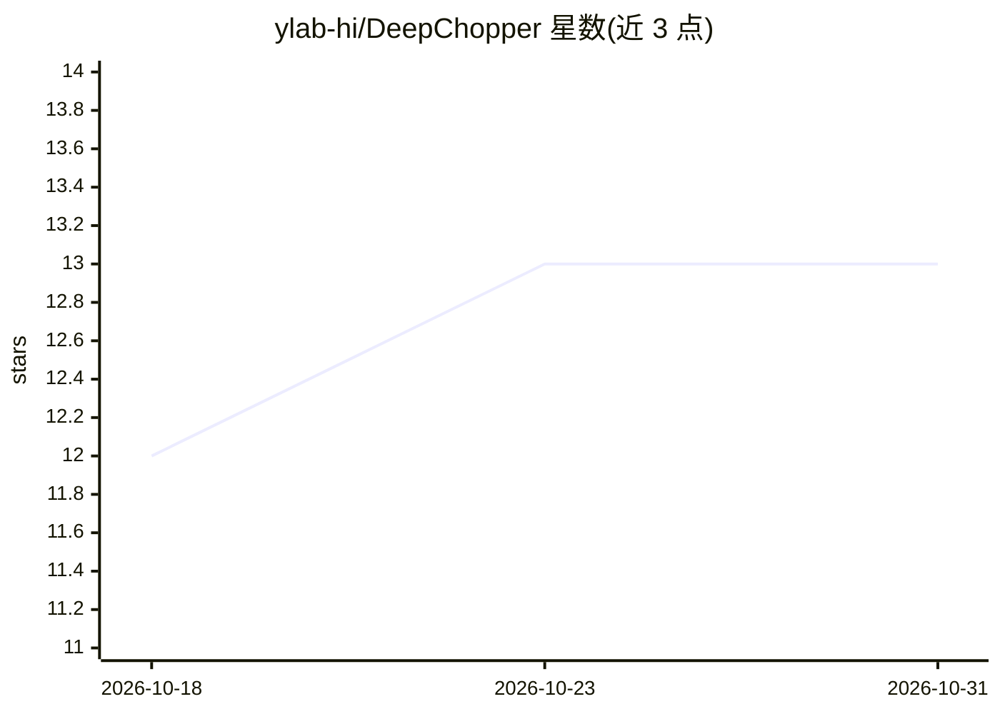

# ylab-hi/DeepChopper

⭐ 13 · Rust · Apache-2.0 · 推送 2026-10-19 · [GitHub](https://github.com/ylab-hi/DeepChopper) · [官网](https://ylab-hi.github.io/DeepChopper/) · 组织维护

**检测并切除 Nanopore 直接 RNA 测序嵌合 reads 的语言模型工具**

面向生物信息研究者，基于基因组语言模型（yangliz5/deepchopper 预训练权重）识别 Nanopore 直接 RNA 测序中可能形成嵌合 reads 的人工序列。v1.3.0 起直接读取 FASTQ（含 .gz），工作流为 predict→chop 两条命令，支持 GPU 与多平台 pip 安装（Python 3.10-3.12，Linux/macOS/Windows），也可作为 Python 库调用。提供 Hugging Face Spaces 在线演示，但限单条 FASTQ 记录。附带可引用论文。

## 筛选速览

| 维度 | 判定 | 备注 |
|---|---|---|
| AI 角色 | `ai-native` | 本体是模型或模型工具 |
| 许可风险 | `permissive` | Apache-2.0 |
| 部署形态 | `library` | 以包/库形式分发 |
| 模型依赖 | — | README 未给出锁定关系 |
| 硬件要求 | — | 无带数字的原话,不猜 |
| 安装摩擦 | `low` | 无编译、无系统依赖或容器化 |
| 成熟度 | — | 结构信号不足 |

## 能力要点

- 语言模型预测并切除嵌合 reads（predict→chop 两命令工作流）
- 直接处理 .fastq/.fq/.gz 格式并自动识别
- 支持 --gpus GPU 加速
- 提供 Hugging Face Spaces 在线演示与 Python 库接口

## 适用场景

- 清理 Nanopore 直接 RNA 测序数据中的嵌合 reads
- 将嵌合体检测整合进现有生信流程（CLI 或 Python 库）
- 快速在线试用验证效果

## 场景标签

 · 领域:生物信息学/测序数据质控

## 证据(README 行号)

> L13: 🧬 DeepChopper leverages a language model to accurately detect and chop artificial sequences that may cause chimeric
> L130: model = deepchopper.DeepChopper.from_pretrained("yangliz5/deepchopper")
> L139: @article{li2026genomic,

## 星数曲线

2026-10-18 12 → 2026-10-31 13（+1）

---
*卡片 v1 · prompt 1.4 · 生成 2026-10-31 · 置信度 high · 依据 README sha `4b87569b89e8` · [字段定义](../../DATASET.md)*
