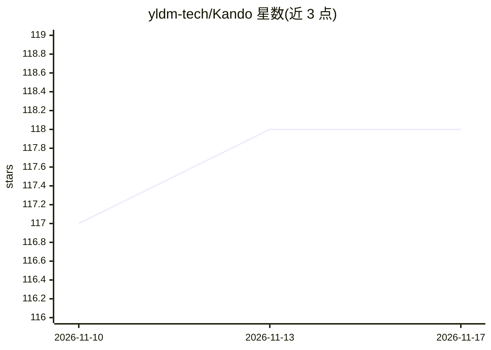

# yldm-tech/Kando

⭐ 118 · Go · MIT · 推送 2026-11-16 · [GitHub](https://github.com/yldm-tech/Kando) · [官网](https://kando.yldm.ai) · 个人维护 · 中文 README

**用视频学外语的桌面应用：本地转录+逐句翻译双语字幕**

面向语言学习者的桌面应用：粘贴 YouTube/Bilibili 链接或拖入本地视频，用 yt-dlp 下载，在本地用 whisper.cpp 转录语音（7 种模型可选，自动检测语言），再经 OpenAI 兼容 API 逐句翻译，播放时原文与译文同屏显示。提供单句循环、影子跟读、间隔复习（1/3/7/14/30/60 天）、Anki 导出与 AI 逐句讲解等学习工具。内置浏览器与浏览器扩展用于登录后下载会员/年龄限制视频。用 Go 编写，无 web view，界面支持中英日韩等五种语言，默认简体中文。

## 筛选速览

| 维度 | 判定 | 备注 |
|---|---|---|
| AI 角色 | `ai-native` | 本体是模型或模型工具 |
| 许可风险 | `permissive` | MIT |
| 部署形态 | `desktop` | 安装包/桌面程序 |
| 模型依赖 | local-ok | 支持本地模型 |
| 硬件要求 | — | 无带数字的原话,不猜 |
| 安装摩擦 | `medium` | 含编译或系统依赖之一 |
| 成熟度 | — | 结构信号不足 |

## 能力要点

- whisper.cpp 本地转录，7 种模型（Tiny 77.7MB 至 Large v3 3.1GB），支持 hf-mirror.com 镜像下载并校验 SHA-256
- 翻译支持 OpenAI 兼容 API 及 OpenRouter/Groq/DeepSeek/Qwen/Kimi/Ollama/LM Studio 等预设
- 双语字幕播放器：逐句循环、跟读暂停、0.1 秒级字幕延迟调整、最多 12 段切片
- 保存句子间隔复习与 Anki 导出（含 ffmpeg 切出的句子音频）

## 适用场景

- 看外语视频配双语字幕学语言，逐句精听跟读
- 把刷过的句子存入复习队列，按间隔重复记忆并导出 Anki
- 批量下载 YouTube/Bilibili 频道或播放列表并生成 srt 双语字幕文件

## 场景标签

`语音识别` · 领域:感知与多模态

## 证据(README 行号)

> L15: Kando is a desktop app for learning a language from videos in that language. Paste a YouTube or Bilibili link, or d
> L27: - Speech is recognized on your computer with whisper.cpp, which detects the spoken language. Settings › Speech Reco
> L28: - Lines are translated by EveryAPI by default, or by any OpenAI-compatible chat API: Settings › AI Service has pres

## 星数曲线

2026-11-10 117 → 2026-11-17 118（+1）

---
*卡片 v1 · prompt 1.4 · 生成 2026-11-17 · 置信度 high · 依据 README sha `c7fb7d472395` · [字段定义](../../DATASET.md)*
