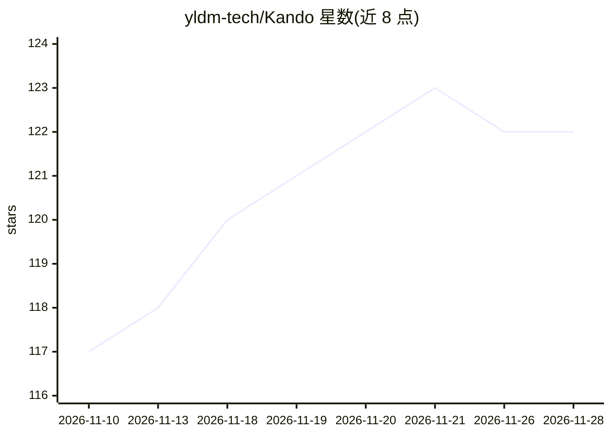

# yldm-tech/Kando

⭐ 122 · Go · NOASSERTION · 推送 2026-11-27 · [GitHub](https://github.com/yldm-tech/Kando) · [官网](https://kando.yldm.ai) · 个人维护 · 中文 README

**视频语言学习桌面应用：本地转写并生成双语字幕**

用 Go 编写的桌面应用：粘贴 YouTube/Bilibili 链接或拖入本地视频/音频文件，经 yt-dlp 下载后在本机用 whisper.cpp 逐行转写，内置 Silero 语音活动检测过滤音乐与静音以减少虚构台词，再通过 OpenAI 兼容的聊天 API 逐行翻译，转写完成后 AI 还会依据标题与上下文校对易错词。播放器支持双语/原文/译文/关闭四种字幕模式、逐行循环与逐句停顿等跟读功能，并输出原文与双语两份 SRT。界面提供英/简中/繁中/日/韩五种语言，默认简体中文。

## 筛选速览

| 维度 | 判定 | 备注 |
|---|---|---|
| AI 角色 | `ai-native` | 本体是模型或模型工具 |
| 许可风险 | `none` | NOASSERTION |
| 部署形态 | `desktop` | 安装包/桌面程序 |
| 模型依赖 | local-ok | 支持本地模型 |
| 硬件要求 | — | 无带数字的原话,不猜 |
| 安装摩擦 | `medium` | 含编译或系统依赖之一 |
| 成熟度 | — | 结构信号不足 |

## 能力要点

- whisper.cpp 本地转写，配 Silero VAD 与 DTW 词级时间戳
- 通过 OpenAI 兼容 API 翻译，内置 12 家服务预设及自定义端点
- AI 依视频标题与上下文校对转写错听词，仅做同位替换不改写句子
- 浏览器扩展与内置浏览器支持 YouTube/Bilibili 等站点的站内下载按钮

## 适用场景

- 看外语视频学语言，需要逐行对照的双语字幕
- 给本地视频或音频（播客/有声书）批量生成翻译字幕
- 用逐行循环和停顿功能做跟读练习
- 导出双语 SRT 供 Plex/Jellyfin 等播放器使用

## 场景标签

`语音识别` · 领域:感知与多模态

## 证据(README 行号)

> L15: Kando is a desktop app for learning a language from videos in that language. Paste a YouTube or Bilibili link, or d
> L29: - Speech is recognized on your computer with whisper.cpp. Kando first finds where people speak, with the Silero voi
> L30: - Lines are translated by EveryAPI by default, or by any OpenAI-compatible chat API: Settings › AI Service has pres

## 星数曲线

2026-11-10 117 → 2026-11-28 122（+5）

---
*卡片 v1 · prompt 1.4 · 生成 2026-11-28 · 置信度 high · 依据 README sha `63b7878d16eb` · [字段定义](../../DATASET.md)*
