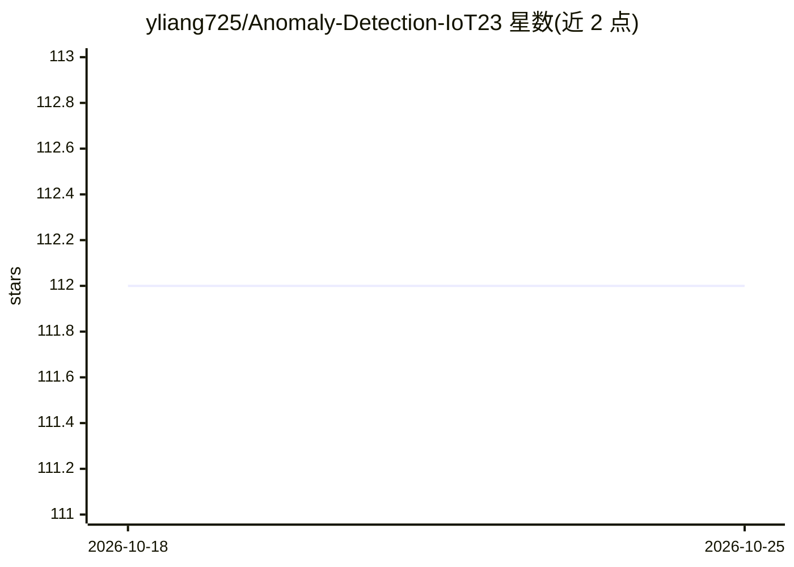

# yliang725/Anomaly-Detection-IoT23

⭐ 112 · Jupyter Notebook · GPL-3.0 · 推送 2026-02-22 · [GitHub](https://github.com/yliang725/Anomaly-Detection-IoT23) · 个人维护

**IoT-23 数据集网络流量异常检测研究：ML/DL 模型实现与对比**

一个研究项目仓库，配套论文《Machine Learning and Deep Learning Methods for Better Anomaly Detection in IoT-23 Dataset Cybersecurity》。内容为 IoT-23 数据集预处理（加载 23 个子集各 100,000 行合并为 iot23_combined.csv）及 4 种模型实现：CNN、SVM、决策树、朴素贝叶斯，以时间效率与准确率评估。运行环境为 Anaconda Jupyter Notebook、Python 3.8、TensorFlow 2.4。README 开头声明论文遭 IEEE Xplore 抄袭并已举报。仓库声明采用双许可模型。

## 筛选速览

| 维度 | 判定 | 备注 |
|---|---|---|
| AI 角色 | `ai-native` | 本体是模型或模型工具 |
| 许可风险 | `viral` | GPL-3.0 |
| 部署形态 | `None` |  |
| 模型依赖 | — | README 未给出锁定关系 |
| 硬件要求 | — | 无带数字的原话,不猜 |
| 安装摩擦 | `low` | 无编译、无系统依赖或容器化 |
| 成熟度 | — | 结构信号不足 |

## 能力要点

- 实现 CNN/SVM/决策树/朴素贝叶斯 4 种模型
- IoT-23 数据集预处理脚本，合并 23 个子集为 iot23_combined.csv
- 以时间效率与准确率为评估目标
- 包含配套研究论文并声明抄袭事件

## 适用场景

- 复现 IoT-23 异常检测的 ML/DL 实验结果
- 参考 IoT 网络流量数据的预处理流程
- 对比多种机器学习方法在 IoT 安全数据上的表现

## 场景标签

`网络安全` · 领域:学习与行业

## 证据(README 行号)

> L23: * This paper proposed an anomaly detection system model for IoT security with the implementation of ML/DL methods, 
> L33: There are total of 4 models are implemented in this project:

## 星数曲线

2026-10-18 112 → 2026-10-25 112（+0）

---
*卡片 v1 · prompt 1.4 · 生成 2026-10-23 · 置信度 high · 依据 README sha `2563373f2350` · [字段定义](../../DATASET.md)*
