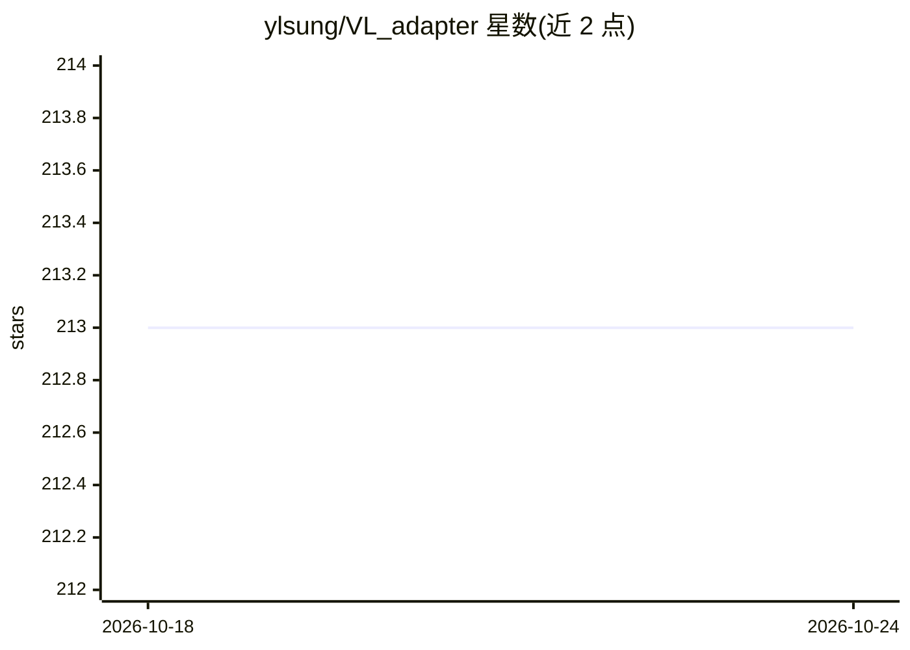

# ylsung/VL_adapter

⭐ 213 · Python · MIT · 推送 2026-09-26 · [GitHub](https://github.com/ylsung/VL_adapter) · 个人维护

**CVPR 2022 论文 VL-Adapter 官方代码：视觉-语言任务参数高效迁移学习**

论文 'VL-Adapter: Parameter-Efficient Transfer Learning for Vision-and-Language Tasks'（CVPR 2022）的 PyTorch 官方实现，作者 Yi-Lin Sung、Jaemin Cho、Mohit Bansal。在统一多任务设定下于图像-文本（VQAv2、GQA、NLVR2、MSCOCO）与视频-文本（TVQA、How2QA、TVC、YC2C）基准上评估 adapter 方法；权重共享 adapter 仅训练 4.18%（图像-文本）/3.39%（视频-文本）参数即可达到全量微调性能。代码基于 VL-T5 改写，另含 CLIP-ViL 子目录；数据经 HuggingFace Hub 分发（约 47GB 下载、132GB 磁盘）。

## 筛选速览

| 维度 | 判定 | 备注 |
|---|---|---|
| AI 角色 | `ai-native` | 本体是模型或模型工具 |
| 许可风险 | `permissive` | MIT |
| 部署形态 | `library` | 以包/库形式分发 |
| 模型依赖 | — | README 未给出锁定关系 |
| 硬件要求 | — | 无带数字的原话,不猜 |
| 安装摩擦 | `low` | 无编译、无系统依赖或容器化 |
| 成熟度 | — | 结构信号不足 |

## 能力要点

- 图像-文本与视频-文本 8 个基准上的统一多任务评估
- 权重共享 adapter 仅训练约 4% 参数即可匹敌全量微调
- 提供从 HuggingFace Hub 恢复数据集的脚本（支持断点续传与单数据集恢复）
- 支持全量微调与多种参数高效方法的运行脚本

## 适用场景

- 复现 VL-Adapter 论文实验结果
- 研究视觉-语言任务的参数高效迁移学习方法
- 在 VQAv2/GQA/NLVR2/MSCOCO 等基准上训练与比较 adapter 变体

## 场景标签

 · 领域:多模态机器学习研究

## 证据(README 行号)

> L4: * Paper: "VL-Adapter: Parameter-Efficient Transfer Learning for Vision-and-Language Tasks" (CVPR 2022)
> L6: We evaluate VL-adapter in a unified multi-task
> L9: Our results demonstrate that training the adapter with the weight-sharing technique (4.18% of total parameters for i

## 星数曲线

2026-10-18 213 → 2026-10-24 213（+0）

---
*卡片 v1 · prompt 1.4 · 生成 2026-10-22 · 置信度 mid · 依据 README sha `694279367f1e` · [字段定义](../../DATASET.md)*
