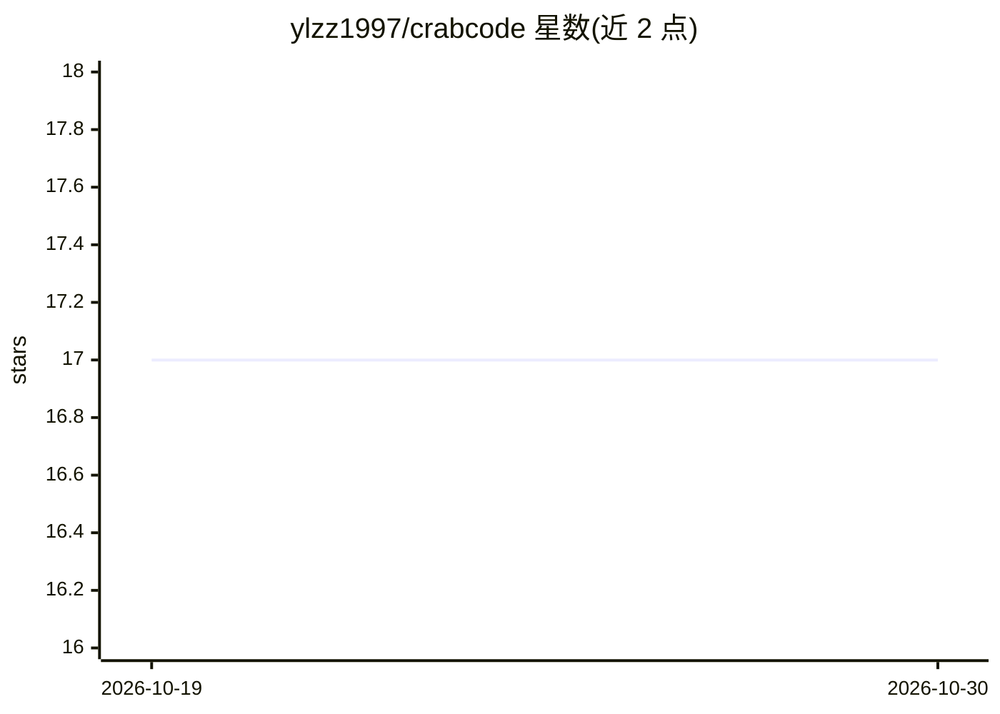

# ylzz1997/crabcode

⭐ 17 · Python · 推送 2026-10-28 · [GitHub](https://github.com/ylzz1997/crabcode) · 个人维护 · 中文 README

**终端 AI 编程助手：兼容 Claude Code Agent/Skills 的 Python 实现**

用 Python 重写的终端 AI coding assistant，前后端分离架构：crabcode-core 引擎处理 API 调用、工具执行、会话管理与 MCP 集成，crabcode-cli 提供 rich/prompt_toolkit 交互 REPL。可选组件包括 USearch 向量索引的语义代码搜索、多协议（HTTP/gRPC/WebSocket/SSE）网关服务。功能含会话 fork/恢复、持久化目标与 token 预算、后台任务与定时任务、多 agent 团队协作、文件快照 checkpoint 回滚，以及 Queue/Steer 两种运行中追问模式。支持多 API 提供商。

## 筛选速览

| 维度 | 判定 | 备注 |
|---|---|---|
| AI 角色 | `ai-native` | 本体是模型或模型工具 |
| 许可风险 | `none` | — |
| 部署形态 | `library` | 以包/库形式分发 |
| 模型依赖 | local-ok | 支持本地模型 |
| 硬件要求 | — | 无带数字的原话,不猜 |
| 安装摩擦 | `low` | 无编译、无系统依赖或容器化 |
| 成熟度 | — | 结构信号不足 |

## 能力要点

- crabcode-core/cli/search/gateway 四模块前后端分离架构
- 多协议网关（REST/SSE/WebSocket/gRPC）支持 VSCode 扩展与 Web UI 集成
- 会话 fork、搜索、导出与快照 checkpoint 回滚
- 多 agent 团队任务板与跨团队消息机制
- 运行中追问支持 Queue（FIFO）与 Steer（安全边界插入）两种模式

## 适用场景

- 在终端中用自然语言驱动 AI 修改与理解代码库
- 通过网关将 coding agent 作为网络服务接入 VSCode 扩展或 Web UI
- 跨会话维护可度量的目标并跟踪 token 预算

## 场景标签

`编码 Agent` `多智能体` · 领域:Agent 开发

## 证据(README 行号)

> L5: AI coding assistant in the terminal — a Python reimplementation with a clean, frontend-backend separated architectur
> L11: - **crabcode-core**: The engine. Handles API calls, tool execution, prompt construction, session management, and MC
> L113: CrabCode can run as a multi-protocol network service, enabling integration with VSCode extensions, web UIs, and ot

## 星数曲线

2026-10-19 17 → 2026-10-30 17（+0）

---
*卡片 v1 · prompt 1.4 · 生成 2026-10-29 · 置信度 high · 依据 README sha `5684a869f6cd` · [字段定义](../../DATASET.md)*
