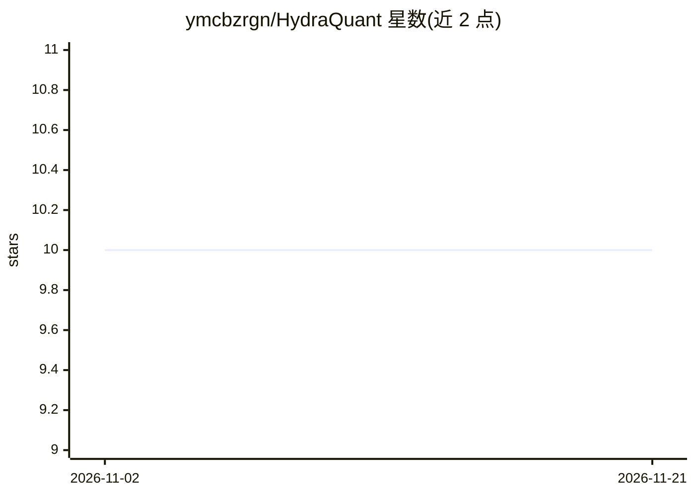

# ymcbzrgn/HydraQuant

⭐ 10 · Python · GPL-3.0 · 推送 2026-05-31 · [GitHub](https://github.com/ymcbzrgn/HydraQuant) · 个人维护

**基于 LLM 与多智能体辩论的加密货币量化交易引擎**

构建在 freqtrade 执行框架之上的加密货币交易系统：规则化 Evidence Engine 先行打分（无 LLM、约 50ms），置信度不足时召集 4-7 个专家智能体进行三轮辩论；每笔平仓交易触发类脑参数体更新（BCM/STDP），仓位由贝叶斯 Kelly 九级管线计算。默认面向 Bybit/Binance 测试网，带分级自主阶梯，仅在持续表现达标后放大仓位。运行完全依赖免费额度 LLM 与免费数据源，提供 Vue 3 仪表盘与 Telegram 通知。

## 筛选速览

| 维度 | 判定 | 备注 |
|---|---|---|
| AI 角色 | `ai-native` | 本体是模型或模型工具 |
| 许可风险 | `viral` | GPL-3.0 |
| 部署形态 | `self-host` | docker 或自建部署 |
| 模型依赖 | locked-api |  |
| 硬件要求 | — | 无带数字的原话,不猜 |
| 安装摩擦 | `low` | 无编译、无系统依赖或容器化 |
| 成熟度 | — | 结构信号不足 |

## 能力要点

- 规则化 Evidence Engine 先行，多数交易决策不经 LLM，零 API 成本
- 12 个专家智能体注册表、按市场状态选取 4-7 个进行三轮辩论
- 7 家免费额度 LLM 提供商，Thompson + LinUCB 路由与熔断器
- 平仓交易驱动参数体演化：学习率、风险阈值、退出乘数持续变异

## 适用场景

- 在 Bybit/Binance 测试网上运行 AI 驱动的加密货币策略
- 用免费额度 LLM 提供商搭建自动化交易闭环
- 需要分级自主与多重风险护栏的个人量化交易

## 场景标签

`多智能体` `金融量化` · 领域:Agent 开发

## 证据(README 行号)

> L13: HydraQuant trades crypto the way a brain does: by remembering, debating, and learning from every signal it sees. Un
> L49: 3. **Evidence Engine.** A rule-based signal generator scores the trade across six independent sub-questions — trend

## 星数曲线

2026-11-02 10 → 2026-11-21 10（+0）

---
*卡片 v1 · prompt 1.4 · 生成 2026-11-19 · 置信度 mid · 依据 README sha `c63c0ed1c319` · [字段定义](../../DATASET.md)*
