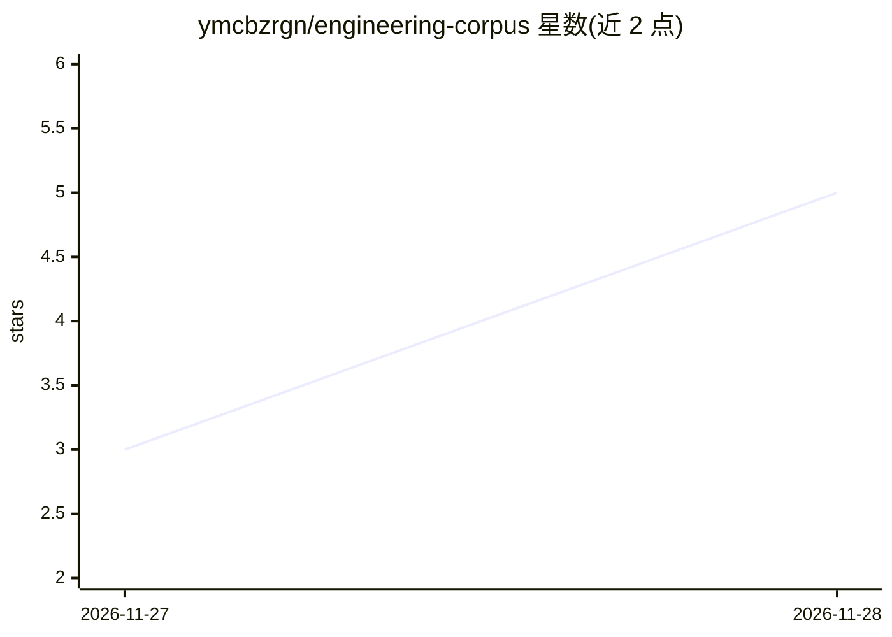

# ymcbzrgn/engineering-corpus

⭐ 5 · Python · MIT · 推送 2026-11-26 · [GitHub](https://github.com/ymcbzrgn/engineering-corpus) · [官网](https://engineeringcorpus.com) · 个人维护

**面向编码 agent 的本地代码语料研究工具，每条引用附精确出处回执**

MCP server 与 CLI：对用户选定的公开 GitHub 仓库建索引（浅克隆、密钥扫描、分块、本地嵌入、LanceDB 存储），七个研究 agent 在 Claude Code/Codex 内检索语料并产出报告，每条引用为 pinned commit 的精确行号加许可证类别（P/B/W/C/R/U 六类自动判定）。引擎 MIT、本地运行、CPU 推理，首跑需下载约 600 MB 嵌入模型，仅支持公开仓库，许可证判定声明非法律建议。

## 筛选速览

| 维度 | 判定 | 备注 |
|---|---|---|
| AI 角色 | `ai-native` | 本体是模型或模型工具 |
| 许可风险 | `permissive` | MIT |
| 部署形态 | `self-host` | docker 或自建部署 |
| 模型依赖 | — | README 未给出锁定关系 |
| 硬件要求 | `cpu-ok` | |
| 安装摩擦 | `low` | 无编译、无系统依赖或容器化 |
| 成熟度 | — | 结构信号不足 |

## 能力要点

- 七个研究 agent（corpus-miner、prior-art-researcher 等）+ 十二个只读语料工具
- 每条引用输出回执：repo@commit、文件行号、许可证类别与 SPDX id
- granite-embedding 本地 CPU 嵌入，混合检索（向量 + 词项 + tree-sitter 符号）
- 内置密钥扫描与许可证六类自动判定

## 适用场景

- 让编码 agent 研究开源项目如何解决同类问题并给出可核验出处
- 只允许宽松许可证时筛选可复用的代码片段
- 对比不同项目对同一问题（如重试策略）的实现差异

## 场景标签

`语义搜索` · 领域:知识与检索

## 证据(README 行号)

> L7: Engineering Corpus: real code your agent can cite. Research agents read the repos you choose, and every report ends 
> L9: Research agents that cite their sources. My agents kept forgetting the repos I told them to learn from and made up s
> L26: The Quickstart connects it to Claude Code or Codex.

## 星数曲线

2026-11-27 3 → 2026-11-28 5（+2）

---
*卡片 v1 · prompt 1.4 · 生成 2026-11-27 · 置信度 high · 依据 README sha `4e9bbc07c800` · [字段定义](../../DATASET.md)*
