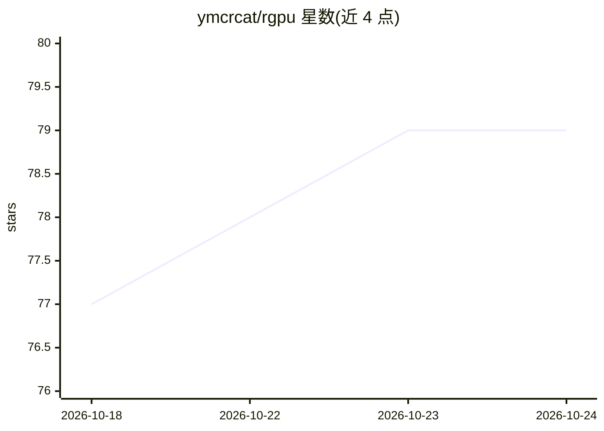

# ymcrcat/rgpu

⭐ 79 · C++ · Apache-2.0 · 推送 2026-10-22 · [GitHub](https://github.com/ymcrcat/rgpu) · [官网](https://rgpu.dev) · 个人维护

**远程 GPU 运行时：本机 Python/PyTorch 程序在远端 NVIDIA GPU 上执行**

rGPU 让客户端程序（如在无 CUDA 的 Mac 上）将 GPU 计算卸载到远程 NVIDIA 机器：一条路径提供 PyTorch `rgpu` 设备，torch 张量与操作经 TCP 在远端执行；另一条路径以 libcuda/CUDA Runtime/cuBLAS/cuBLASLt/cuDNN shim 形式支持现有 Linux CUDA 程序（含原生 CUDA PyTorch 构建，README 展示在容器内经 shim 运行 Ollama 与 llama.cpp 的录屏）。通过 `rgpu-run` 建立 SSH 隧道连接；协议本身不认证不加密，默认绑定 localhost 并建议以 SSH 与防火墙限制。以 pip 安装的 Python 包与 C++ 客户端构建脚本两种形式提供。

## 筛选速览

| 维度 | 判定 | 备注 |
|---|---|---|
| AI 角色 | `ai-ecosystem` | LLM/agent 周边工具 |
| 许可风险 | `permissive` | Apache-2.0 |
| 部署形态 | `library` | 以包/库形式分发 |
| 模型依赖 | — | README 未给出锁定关系 |
| 硬件要求 | — | 无带数字的原话,不猜 |
| 安装摩擦 | `medium` | 含编译或系统依赖之一 |
| 成熟度 | — | 结构信号不足 |

## 能力要点

- PyTorch `rgpu` 设备：torch 操作经 TCP 在远程 GPU 执行
- CUDA shim 覆盖现有 Linux CUDA 程序（libcuda/cuBLAS/cuDNN 等）
- `rgpu-run` 建立 SSH 隧道并配置连接
- README 提供 Ollama/llama.cpp 经 CUDA shim 远程运行的演示

## 适用场景

- 在无 NVIDIA GPU 的 Mac 上运行 PyTorch 训练/推理
- 让现有 CUDA 程序（如容器内 Ollama）使用远程 GPU
- 租用云 GPU 而不改动本地工作环境

## 场景标签

 · 领域:GPU 计算基础设施/深度学习

## 证据(README 行号)

> L10: |PyTorch device|PyTorch programs that can opt into an `rgpu` device|`torch` operations over TCP|
> L11: |CUDA shim|Existing Linux CUDA programs, including stock CUDA PyTorch|`libcuda`, CUDA Runtime, cuBLAS, cuBLASLt, an

## 星数曲线

2026-10-18 77 → 2026-10-24 79（+2）

---
*卡片 v1 · prompt 1.4 · 生成 2026-10-24 · 置信度 high · 依据 README sha `93e39a6ae501` · [字段定义](../../DATASET.md)*
