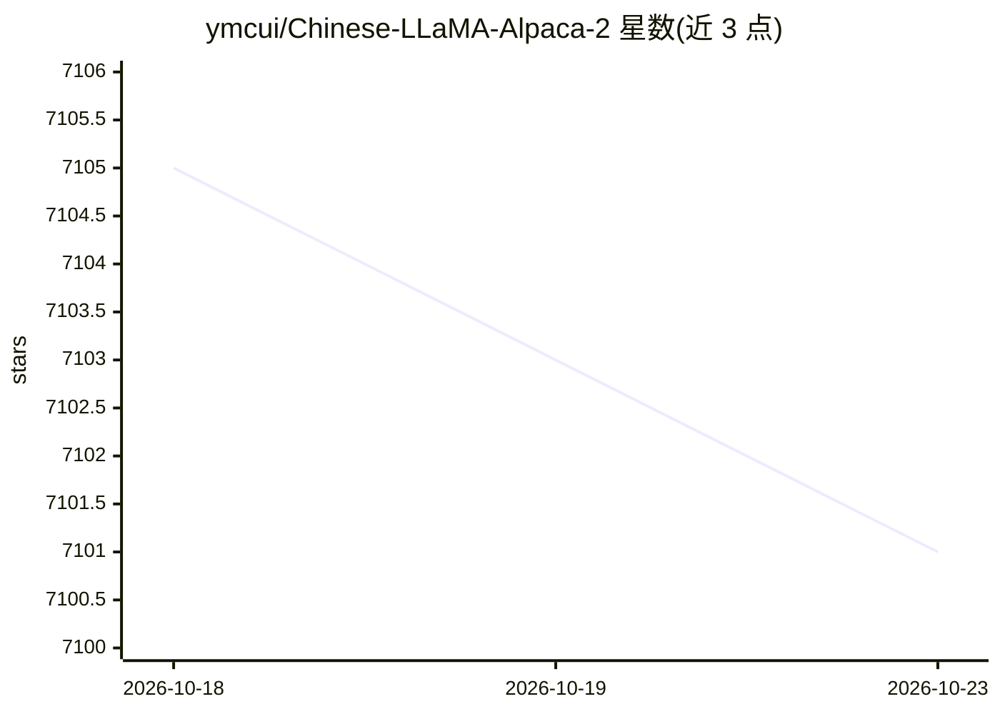

# ymcui/Chinese-LLaMA-Alpaca-2

⭐ 7,101 · Python · Apache-2.0 · 推送 2026-04-19 · [GitHub](https://github.com/ymcui/Chinese-LLaMA-Alpaca-2) · 组织维护 · 中文 README

**基于 Llama-2 的中文扩充开源大模型系列（含 64K 长上下文与 RLHF 版）**

在 Meta Llama-2 基础上扩充并优化中文词表（55,296），使用 120G 中文语料增量预训练并开源 Chinese-LLaMA-2 基座模型与 Chinese-Alpaca-2 指令精调模型（1.3B/7B/13B），提供 16K/64K 长上下文版（PI/YaRN）与 RLHF 偏好对齐版。模型经 FlashAttention-2 训练，支持 transformers、llama.cpp、text-generation-webui、vLLM 等生态，可在个人电脑 CPU/GPU 上量化部署；同时开源预训练与指令精调脚本。项目已宣布三期（基于 Llama-3）发布并推荐用户升级。

## 筛选速览

| 维度 | 判定 | 备注 |
|---|---|---|
| AI 角色 | `ai-native` | 本体是模型或模型工具 |
| 许可风险 | `permissive` | Apache-2.0 |
| 部署形态 | `None` |  |
| 模型依赖 | local-ok | 支持本地模型 |
| 硬件要求 | — | 无带数字的原话,不猜 |
| 安装摩擦 | `low` | 无编译、无系统依赖或容器化 |
| 成熟度 | — | 结构信号不足 |

## 能力要点

- 中文词表扩充至 55,296 并以 120G 中文语料增量预训练
- 16K/64K 长上下文版（基于 PI/YaRN）与 RLHF 偏好对齐版模型
- 提供 GGUF/AWQ 量化版本，支持个人电脑 CPU/GPU 本地部署
- 开源预训练与指令精调脚本，用户可继续训练

## 适用场景

- 本地部署中文对话模型做问答、写作与聊天
- 长文本为主的下游任务使用 16K/64K 长上下文版
- 基于开源脚本进一步训练或精调自己的中文模型

## 场景标签

`模型训练` `微调` · 领域:训练与推理

## 证据(README 行号)

> L9: 本项目基于Meta发布的可商用大模型Llama-2开发，是中文LLaMA&Alpaca大模型的第二期项目，开源了**中文LLaMA-2基座模型和Alpaca-2指令精调大模型**。这些模型**在原版Llama-2的基础上扩充并优化了
> L20: - 基座模型（4K上下文）：Chinese-LLaMA-2 (1.3B, 7B, 13B)
> L24:  - Chinese-LLaMA-2-64K (7B)、Chinese-Alpaca-2-64K (7B)

## 星数曲线

2026-10-18 7,105 → 2026-10-23 7,101（-4）

---
*卡片 v1 · prompt 1.4 · 生成 2026-10-20 · 置信度 high · 依据 README sha `42d00bb98c60` · [字段定义](../../DATASET.md)*
