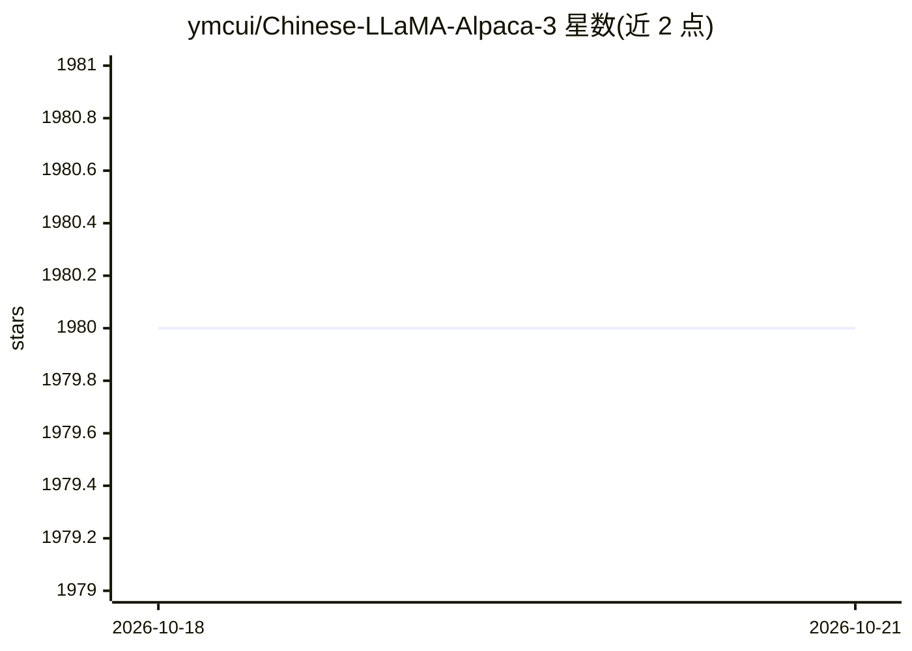

# ymcui/Chinese-LLaMA-Alpaca-3

⭐ 1,979 · Python · Apache-2.0 · 推送 2026-04-19 · [GitHub](https://github.com/ymcui/Chinese-LLaMA-Alpaca-3) · 个人维护 · 中文 README

**基于 Meta Llama-3 的中文增量预训练与指令精调开源大模型**

Chinese-LLaMA-Alpaca 系列第三期项目，开源 Llama-3-Chinese-8B 基座模型与三个版本的 Instruct 指令模型：在原版 Llama-3 上用约 120GB 中文语料增量预训练（LoRA + 全量 emb/lm-head），再用约 500 万条指令数据精调；v3 由多个指令模型融合并少量精调得到。词表沿用原版 128K BPE，上下文 8K。同时开源预训练/精调脚本、指令数据集，并提供 llama.cpp、transformers、vLLM、Ollama、text-generation-webui、LM Studio 等量化部署教程，GGUF 量化格式适配本地推理工具。模型权重托管于 Hugging Face、ModelScope、wisemodel。

## 筛选速览

| 维度 | 判定 | 备注 |
|---|---|---|
| AI 角色 | `ai-native` | 本体是模型或模型工具 |
| 许可风险 | `permissive` | Apache-2.0 |
| 部署形态 | `None` |  |
| 模型依赖 | local-ok | 支持本地模型 |
| 硬件要求 | — | 无带数字的原话,不猜 |
| 安装摩擦 | `low` | 无编译、无系统依赖或容器化 |
| 成熟度 | — | 结构信号不足 |

## 能力要点

- 开源 Llama-3-Chinese-8B 基座模型与 Instruct v1/v2/v3 指令模型（完整版/LoRA/GGUF）
- 提供预训练脚本、指令精调脚本及 alpaca_zh_51k 等指令数据
- 支持 llama.cpp、transformers、vLLM、Ollama、text-generation-webui 等部署方式
- 提供 C-Eval、CMMLU、MMLU、LongBench 等基准评测结果与在线模型竞技场

## 适用场景

- 需要中文问答、写作、聊天能力的本地大模型部署
- 在开源中文模型基础上做进一步训练或微调
- 对比评测中文 Llama-3 系列各版本在 C-Eval/LongBench 等基准的表现

## 场景标签

 · 领域:自然语言处理/大语言模型

## 证据(README 行号)

> L13: 本项目基于Meta最新发布的新一代开源大模型Llama-3开发，是Chinese-LLaMA-Alpaca开源大模型相关系列项目（一期、二期）的第三期。本项目开源了**中文Llama-3基座模型和中文Llama-3-Instruc
> L17: - 🚀 开源Llama-3-Chinese基座模型和Llama-3-Chinese-Instruct指令模型（v1, v2, v3）

## 星数曲线

2026-10-18 1,980 → 2026-10-21 1,980（+0）

---
*卡片 v1 · prompt 1.4 · 生成 2026-10-21 · 置信度 high · 依据 README sha `cc955abcff51` · [字段定义](../../DATASET.md)*
