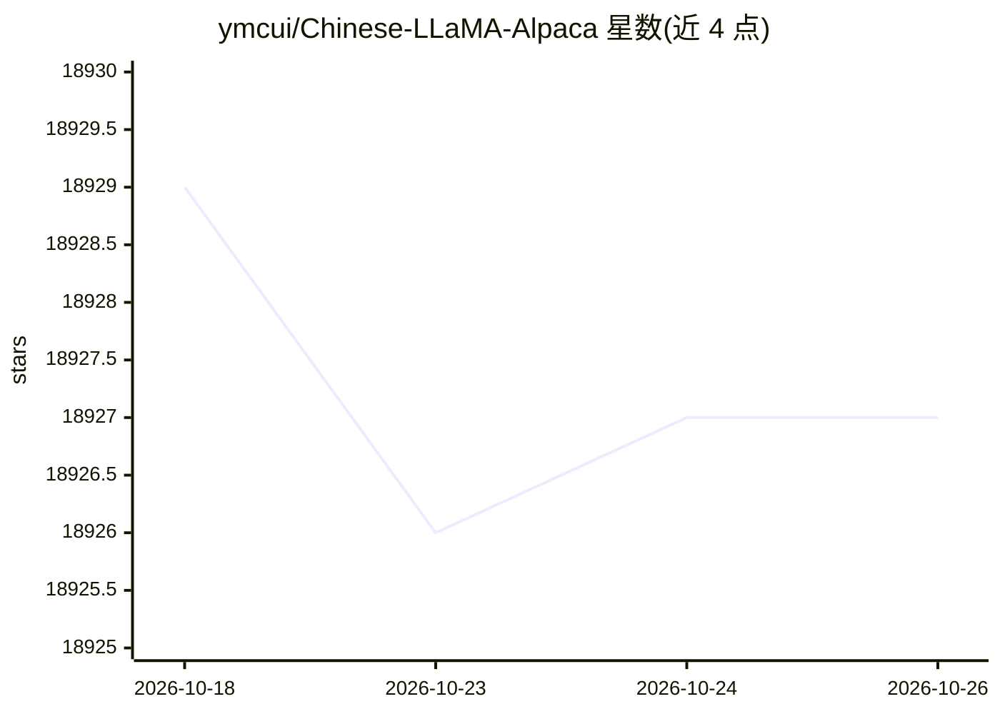

# ymcui/Chinese-LLaMA-Alpaca

⭐ 18,927 · Python · Apache-2.0 · 推送 2026-04-19 · [GitHub](https://github.com/ymcui/Chinese-LLaMA-Alpaca) · [官网](https://github.com/ymcui/Chinese-LLaMA-Alpaca/wiki) · 个人维护 · 中文 README

**在LLaMA上扩充中文词表并二次预训练/精调的开源中文大模型**

开源中文LLaMA基座模型与指令精调的中文Alpaca模型：在原版LLaMA上扩充中文词表、用中文语料二次预训练，Alpaca再经中文指令数据精调。发布LoRA权重（7B/13B/33B，基础/Plus/Pro版），需与原版LLaMA合并后使用；同时开源预训练与指令精调脚本。支持llama.cpp、transformers、text-generation-webui、LlamaChat、LangChain、privateGPT等量化推理与本地CPU/GPU部署，提供C-Eval评测结果与在线竞技场。

## 筛选速览

| 维度 | 判定 | 备注 |
|---|---|---|
| AI 角色 | `ai-native` | 本体是模型或模型工具 |
| 许可风险 | `permissive` | Apache-2.0 |
| 部署形态 | `None` |  |
| 模型依赖 | — | README 未给出锁定关系 |
| 硬件要求 | — | 无带数字的原话,不猜 |
| 安装摩擦 | `low` | 无编译、无系统依赖或容器化 |
| 成熟度 | — | 结构信号不足 |

## 动量与使用信号

- 维护:`declining` — 距上次 push 182.3 天,年发版 0,10 位贡献者
- 涨星:近 1 天 **+1**(自 20261016 起算)
- 平台:WEB · 协议:OPENAI-API

## 能力要点

- 扩充中文词表并开源中文二次预训练与指令精调模型（LoRA权重，7B-33B）
- 开源预训练脚本与指令精调脚本，可继续训练
- 支持llama.cpp、transformers、text-generation-webui、LlamaChat、LangChain、privateGPT等部署方式
- 支持个人电脑CPU/GPU本地量化部署

## 适用场景

- 在中文NLP研究中使用或继续预训练开源大模型
- 在个人电脑上量化部署并体验中文对话模型
- 基于开源脚本进行指令精调训练自己的模型

## 场景标签

`模型训练` `微调` · 领域:训练与推理

## 证据(README 行号)

> L10: 本项目开源了**中文LLaMA模型和指令精调的Alpaca大模型**，以进一步促进大模型在中文NLP社区的开放研究。这些模型**在原版LLaMA的基础上扩充了中文词表**并使用了中文数据进行二次预训练，进一步提升了中文基础语义理解
> L19: - 🚀 快速使用笔记本电脑（个人PC）的CPU/GPU本地量化和部署体验大模型
> L20: - 🚀 支持🤗transformers, llama.cpp, text-generation-webui, LlamaChat, LangChain, privateGPT等生态

## 星数曲线

2026-10-18 18,929 → 2026-10-26 18,927（-2）

---
*卡片 v1 · prompt 1.4 · 生成 2026-10-18 · 置信度 high · 依据 README sha `e593f9f6ec81` · [字段定义](../../DATASET.md)*
