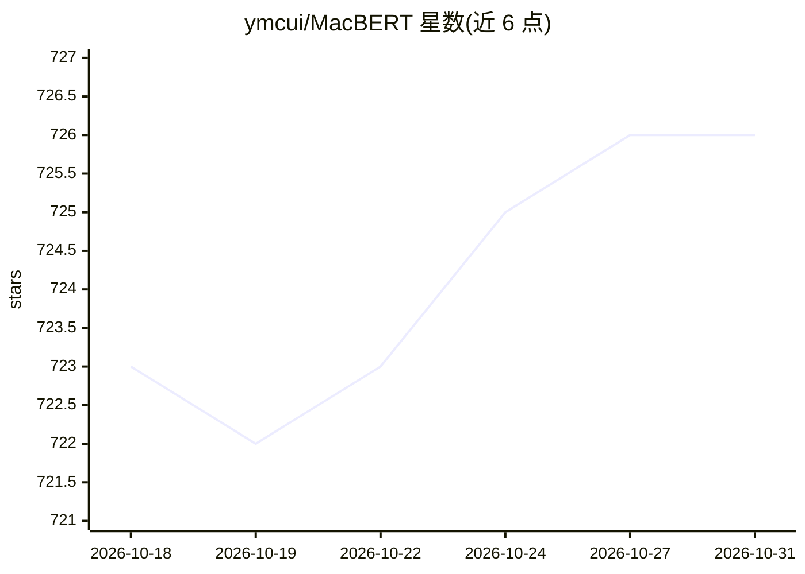

# ymcui/MacBERT

⭐ 726 · Apache-2.0 · 推送 2026-04-19 · [GitHub](https://github.com/ymcui/MacBERT) · [官网](https://www.aclweb.org/anthology/2020.findings-emnlp.58/) · 组织维护 · 中文 README

**中文预训练 BERT 改进模型，供 NLP 下游任务使用**

MacBERT 是 BERT 的改进版本，由哈工大讯飞联合实验室发布，引入纠错型掩码语言模型（MLM as correction）预训练任务：用相似词取代[MASK]标记，并结合全词掩码与 N-gram 掩码，缓解预训练与下游任务不一致的问题。框架与 BERT 完全一致，可在不修改现有代码的情况下过渡，通过 Transformers 以 BertModel 加载。提供 base（102M）与 large（324M）两个规模的中文模型权重下载，README 给出 6 个中文下游任务的基线结果。训练代码与语料未开源，无英文版。

## 筛选速览

| 维度 | 判定 | 备注 |
|---|---|---|
| AI 角色 | `ai-native` | 本体是模型或模型工具 |
| 许可风险 | `permissive` | Apache-2.0 |
| 部署形态 | `None` |  |
| 模型依赖 | — | README 未给出锁定关系 |
| 硬件要求 | — | 无带数字的原话,不猜 |
| 安装摩擦 | `low` | 无编译、无系统依赖或容器化 |
| 成熟度 | — | 结构信号不足 |

## 能力要点

- 纠错型掩码策略：用相似词替代[MASK]标记
- 框架与 BERT 一致，现有代码无需修改即可过渡
- 提供 base/large 两级中文模型权重（HF 与百度盘下载）
- 在阅读理解、自然语言推断、情感分类等 6 个任务给出基线结果

## 适用场景

- 中文文本分类、句对匹配、情感分析等下游任务
- 中文抽取式阅读理解（简体/繁体）
- 替换现有 BERT 流程以使用该预训练权重微调

## 场景标签

 · 领域:自然语言处理/预训练模型

## 证据(README 行号)

> L7: 本目录包含**MacBERT预训练模型**，该模型引入了一种纠错型掩码语言模型（Mac）预训练任务，缓解了“预训练-下游任务”不一致的问题。MacBERT在多种NLP任务上取得了显著性能提升。
> L35: **MacBERT** 是BERT的改进版本，引入了纠错型掩码语言模型（MLM as correction，Mac）预训练任务，缓解了“预训练-下游任务”不一致的问题。

## 星数曲线

2026-10-18 723 → 2026-10-31 726（+3）

---
*卡片 v1 · prompt 1.4 · 生成 2026-10-21 · 置信度 high · 依据 README sha `74798164b145` · [字段定义](../../DATASET.md)*
