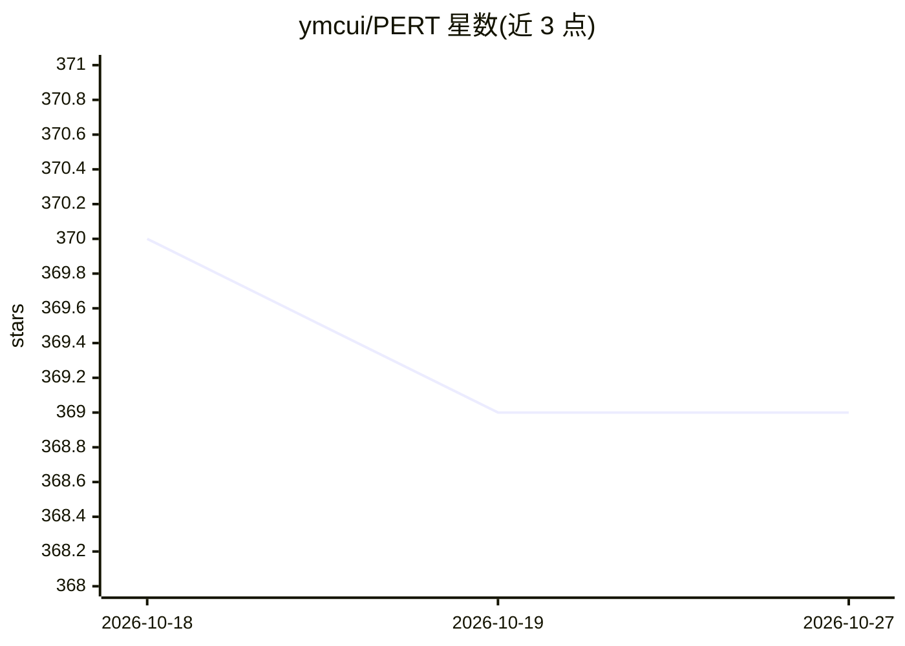

# ymcui/PERT

⭐ 369 · Apache-2.0 · 推送 2026-04-19 · [GitHub](https://github.com/ymcui/PERT) · [官网](https://arxiv.org/abs/2203.06906) · 组织维护 · 中文 README

**基于乱序语言模型的中英文预训练模型（PERT）**

哈工大讯飞联合实验室提出的预训练语言模型项目：PERT 在不引入掩码标记[MASK]的情况下，对输入文本做词序调换，让模型预测原 token 所在位置，自监督学习文本语义。提供中文和英文 PERT 的 base/large 四种权重（TensorFlow 1.15 原版，另有 PyTorch/TF2 版经 Hugging Face transformers 下载），主体仍为 BERT 结构，用 BertTokenizer/BertModel 加载后可做下游任务精调。限制：开源权重仅含 Transformer 部分；在阅读理解、序列标注任务上效果较好，文本分类上效果较差。

## 筛选速览

| 维度 | 判定 | 备注 |
|---|---|---|
| AI 角色 | `ai-native` | 本体是模型或模型工具 |
| 许可风险 | `permissive` | Apache-2.0 |
| 部署形态 | `None` |  |
| 模型依赖 | — | README 未给出锁定关系 |
| 硬件要求 | — | 无带数字的原话,不猜 |
| 安装摩擦 | `low` | 无编译、无系统依赖或容器化 |
| 成熟度 | — | 结构信号不足 |

## 能力要点

- 乱序语言模型预训练目标，不引入[MASK]标记
- 中英文 base/large 四种模型权重（110M/330M 参数）
- 兼容 BERT 结构，可经 transformers 的 BertModel 直接加载
- 提供阅读理解专用 MRC 模型及 Hugging Face 在线交互 Demo

## 适用场景

- 在中英文 NLU 下游任务上以 PERT 为初始权重做精调
- 抽取式阅读理解、命名实体识别等序列标注任务
- 作为二次预训练的初始权重开展研究

## 场景标签

 · 领域:NLP/预训练语言模型

## 证据(README 行号)

> L7: 在自然语言处理领域中，预训练语言模型（Pre-trained Language Models，PLMs）已成为非常重要的基础技术。在近两年，哈工大讯飞联合实验室发布了多种中文预训练模型资源以及相关配套工具。作为相关工作的延续，在本项
> L44: 大体思想：PERT对原始输入文本进行一定的词序调换，从而形成乱序文本（因此不会引入额外的[MASK]标记）。PERT的学习目标是预测原token所在的位置，具体见下例。

## 星数曲线

2026-10-18 370 → 2026-10-27 369（-1）

---
*卡片 v1 · prompt 1.4 · 生成 2026-10-21 · 置信度 high · 依据 README sha `b0c60e60c10d` · [字段定义](../../DATASET.md)*
