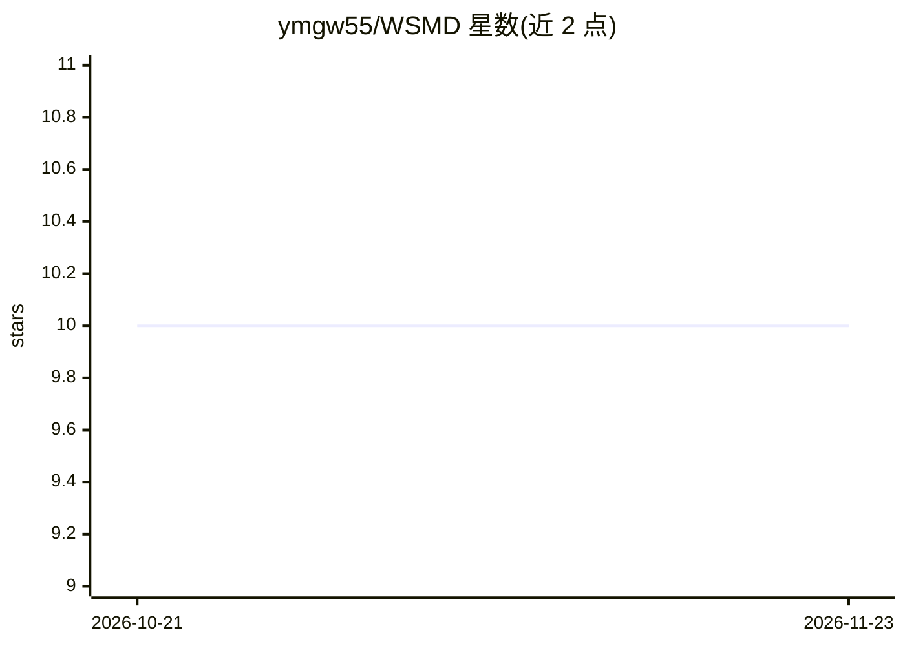

# ymgw55/WSMD

⭐ 10 · Python · MIT · 推送 2026-11-03 · [GitHub](https://github.com/ymgw55/WSMD) · [官网](https://aclanthology.org/2023.findings-emnlp.746/) · 个人维护

**论文配套代码：用自注意力矩阵改进词移动距离的句子相似度计算**

EMNLP 2023 Findings 论文的官方代码仓库。提出 WSMD 方法：在 Word Mover's Distance 基础上引入 BERT 自注意力矩阵（SAM），基于 Fused Gromov-Wasserstein 距离同时考虑词嵌入相似度与句子结构，计算句子间最优传输距离。仓库以 Docker 环境为预设运行方式，流程包括下载 PAWS/STSB/SICK 数据集、获取第三方基线代码、保存嵌入、计算 BV_A 指标及运行评测脚本。面向 NLP 研究者复现论文实验。

## 筛选速览

| 维度 | 判定 | 备注 |
|---|---|---|
| AI 角色 | `ai-knowledge` | 知识聚合/清单类 |
| 许可风险 | `permissive` | MIT |
| 部署形态 | `self-host` | docker 或自建部署 |
| 模型依赖 | — | README 未给出锁定关系 |
| 硬件要求 | — | 无带数字的原话,不猜 |
| 安装摩擦 | `low` | 无编译、无系统依赖或容器化 |
| 成熟度 | — | 结构信号不足 |

## 能力要点

- 基于 Fused Gromov-Wasserstein 距离融合词嵌入与自注意力矩阵
- 提供 BOWS、OWMD、WMDO 等基线的评测脚本
- Docker 环境一键构建运行，支持 GPU
- 提供 BV_A（双向注意力变异性）指标计算脚本

## 适用场景

- 复现 EMNLP 2023 Findings 论文中的句子相似度实验
- 在 PAWS/STSB/SICK 数据集上对比不同最优传输基线
- 研究自注意力矩阵在文本距离度量中的作用

## 场景标签

`模型评测` `科研工具` · 领域:评测与运维

## 证据(README 行号)

> L3: > Improving word mover’s distance by leveraging self-attention matrix
> L5: > *EMNLP 2023 Findings*
> L19: This repository is intended to be executed in a Docker environment.

## 星数曲线

2026-10-21 10 → 2026-11-23 10（+0）

---
*卡片 v1 · prompt 1.4 · 生成 2026-11-19 · 置信度 high · 依据 README sha `90eed05c05b5` · [字段定义](../../DATASET.md)*
