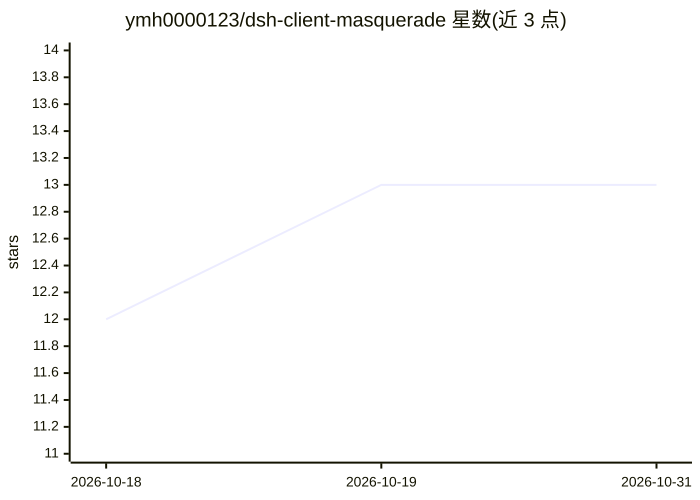

# ymh0000123/dsh-client-masquerade

⭐ 13 · JavaScript · MIT · 推送 2026-08-29 · [GitHub](https://github.com/ymh0000123/dsh-client-masquerade) · 个人维护 · 中文 README

**DeepSeek Harness 插件：让自定义 provider 伪装成 Claude Code/Codex 客户端**

面向 DeepSeek Harness（DSH）用户的插件：为已配置的 llm-pi-ai provider 一键写入伪造的客户端身份请求头（Claude Code / Codex / 自定义预设），使按请求头或请求体识别客户端的中转网关放行请求。机制包括：三个幂等补丁修改已安装的第三方包（User-Agent / 请求体指纹注入 / vision-toolkit 重试转发）、注入 Claude Code 请求体指纹（metadata.user_id、身份 system 块、Glob/Grep/Read 哨兵工具）、排队适配重试策略，以及 mask_client 模型工具与中英双语设置页。需在 Node.js 环境下安装并重启 dsh web 生效；补丁在依赖包重装/升级后需重新应用。

## 筛选速览

| 维度 | 判定 | 备注 |
|---|---|---|
| AI 角色 | `ai-ecosystem` | LLM/agent 周边工具 |
| 许可风险 | `permissive` | MIT |
| 部署形态 | `library` | 以包/库形式分发 |
| 模型依赖 | locked-api |  |
| 硬件要求 | — | 无带数字的原话,不猜 |
| 安装摩擦 | `low` | 无编译、无系统依赖或容器化 |
| 成熟度 | — | 结构信号不足 |

## 能力要点

- Claude Code / Codex / 自定义三套伪装请求头预设，写入 provider 配置随每次请求发送
- 请求体指纹注入：metadata.user_id、身份 system 块与 Glob/Grep/Read 哨兵工具（描述改写为不可用）
- test 动作真实发起流式调用并区分 auth / policy-gate / body-fingerprint / queued 四类失败
- 排队适配：改写 provider retryPolicy（默认 10 次重试、退避 1s→30s）并支持 vision-toolkit 变体路由

## 适用场景

- 让 DSH 的自定义 provider 通过 agentrouter / claude-code-router 等网关的客户端识别
- 排查 429/503 是伪装未生效还是渠道排队
- 为排队型网关配置带退避的长窗口重试策略

## 场景标签

 · 领域:LLM 基础设施/接入工具

## 证据(README 行号)

> L6: 一些网关（如 agentrouter、claude-code-router 类代理）按请求头识别客户端并据此路由或放行。本插件把伪造的客户端身份头写入你的 `llm-pi-ai` provider 配置，随每次请求真实发到上游网关—
> L96: - 伪装头写入 provider 配置的 `headers` 字段（`settings.yaml` 中 `llm-pi-ai.providers.<id>.headers`），由 pi-ai 适配器在**每次请求**（Anthro

## 星数曲线

2026-10-18 12 → 2026-10-31 13（+1）

---
*卡片 v1 · prompt 1.4 · 生成 2026-10-31 · 置信度 high · 依据 README sha `fe8b13a5168c` · [字段定义](../../DATASET.md)*
