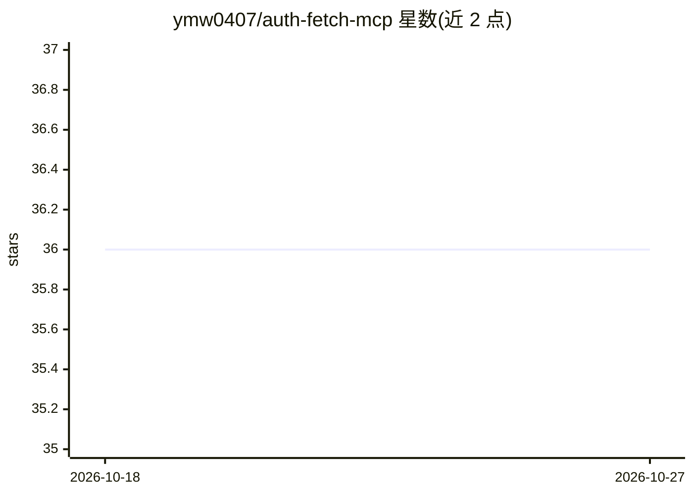

# ymw0407/auth-fetch-mcp

⭐ 36 · TypeScript · MIT · 推送 2026-10-23 · [GitHub](https://github.com/ymw0407/auth-fetch-mcp) · [官网](https://www.npmjs.com/package/auth-fetch-mcp) · 个人维护

**让 AI 助手经用户登录后抓取受保护网页的 MCP server**

基于 Playwright/Chromium 的本地 MCP server，通过 stdio 运行：用户在本地浏览器自行完成登录（含 SSO/双因素）、展开内容后点击 Capture page，AI 获得页面快照（默认可读文本，含来源元数据、链接、媒体与截断警告）。附 download_media 工具用已存会话下载附件，保存的 cookie 便于后续访问。内置本地代理防 DNS 重绑定并默认阻断私网地址，捕获内容会传给 AI 宿主而非仅留在本地。需要 Node.js 20+ 与带显示的桌面环境。

## 筛选速览

| 维度 | 判定 | 备注 |
|---|---|---|
| AI 角色 | `ai-ecosystem` | LLM/agent 周边工具 |
| 许可风险 | `permissive` | MIT |
| 部署形态 | `library` | 以包/库形式分发 |
| 模型依赖 | — | README 未给出锁定关系 |
| 硬件要求 | — | 无带数字的原话,不猜 |
| 安装摩擦 | `low` | 无编译、无系统依赖或容器化 |
| 成熟度 | — | 结构信号不足 |

## 能力要点

- 人工登录确认后捕获已加载 DOM，支持 SSO/双因素
- auth_fetch 返回文本/HTML、来源 URL、链接媒体清单与截断警告
- download_media 基于保存 cookie 批量下载附件（限 50 个/50MiB）
- 本地代理防 DNS 重绑定，默认阻断私网/环回等地址段

## 适用场景

- 让 AI 读取我登录后的项目页、工单或文档并总结
- 抓取需认证页面的附件供 AI 分析
- 在受限内容场景下以本地浏览器+人工确认方式给 AI 提供上下文

## 场景标签

`浏览器自动化` `网页抓取` · 领域:效率与自动化

## 证据(README 行号)

> L6: Let your AI read a login-protected page through a local browser and **your approval**. Sign in yourself, scroll or e
> L14: Requires Node.js 20 or later and a local desktop with a display. Chromium is installed automatically on first brows
> L77: ### `auth_fetch`

## 星数曲线

2026-10-18 36 → 2026-10-27 36（+0）

---
*卡片 v1 · prompt 1.4 · 生成 2026-10-25 · 置信度 high · 依据 README sha `2c8c25aa1de0` · [字段定义](../../DATASET.md)*
