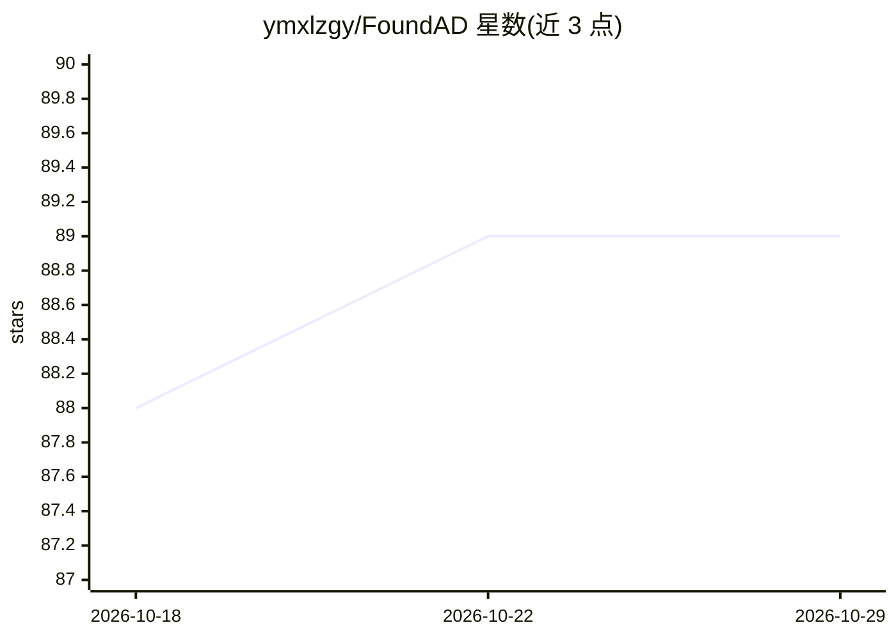

# ymxlzgy/FoundAD

⭐ 89 · Python · MIT · 推送 2026-09-12 · [GitHub](https://github.com/ymxlzgy/FoundAD) · [官网](https://arxiv.org/pdf/2510.01934) · 组织维护

**基于基础视觉编码器的少样本异常检测研究实现**

ICLR 2026 论文 Foundation Visual Encoders Are Secretly Few-Shot Anomaly Detectors 的官方实现，来自慕尼黑工业大学与 MVTec Software GmbH。利用 DINOv3/DINOv2 等基础视觉编码器，在仅 1/2/4 张正常样本的设定下完成工业图像的异常检测与分割；提供预训练 manifold projector 下载（覆盖 MVTec AD 与 VisA 数据集的 1/2/4-shot 配置）、少采样子集生成脚本、训练与推理命令。Python ≥ 3.10，通过 conda + pip 源码安装，使用需自备数据集并确认拥有 DINOv3 使用权限。

## 筛选速览

| 维度 | 判定 | 备注 |
|---|---|---|
| AI 角色 | `ai-native` | 本体是模型或模型工具 |
| 许可风险 | `permissive` | MIT |
| 部署形态 | `library` | 以包/库形式分发 |
| 模型依赖 | — | README 未给出锁定关系 |
| 硬件要求 | — | 无带数字的原话,不猜 |
| 安装摩擦 | `low` | 无编译、无系统依赖或容器化 |
| 成熟度 | — | 结构信号不足 |

## 能力要点

- 利用 DINOv3/DINOv2/CLIP/SigLIP 等基础视觉编码器做少样本异常检测
- 提供 MVTec AD 与 VisA 上 1/2/4-shot 的预训练 projector 权重下载
- sample.py 生成少样本子集，支持训练与推理的完整流程

## 适用场景

- 在工业检测数据集上复现论文的少样本异常检测与分割结果
- 用极少正常样本训练工业图像缺陷检测模型
- 基于基础视觉编码器研究异常检测方法

## 场景标签

`目标检测` · 领域:感知与多模态

## 证据(README 行号)

> L3: The implementation of the paper **Foundation Visual Encoders Are Secretly Few-Shot Anomaly Detectors** ([arXiv](http
> L77: This repo utilizes DINOv3, DINOv2, DINO, SigLIP, CLIP and DINOSigLIP. We also thank I-JEPA for the inspiration.

## 星数曲线

2026-10-18 88 → 2026-10-29 89（+1）

---
*卡片 v1 · prompt 1.4 · 生成 2026-10-23 · 置信度 high · 依据 README sha `8678b98856a1` · [字段定义](../../DATASET.md)*
