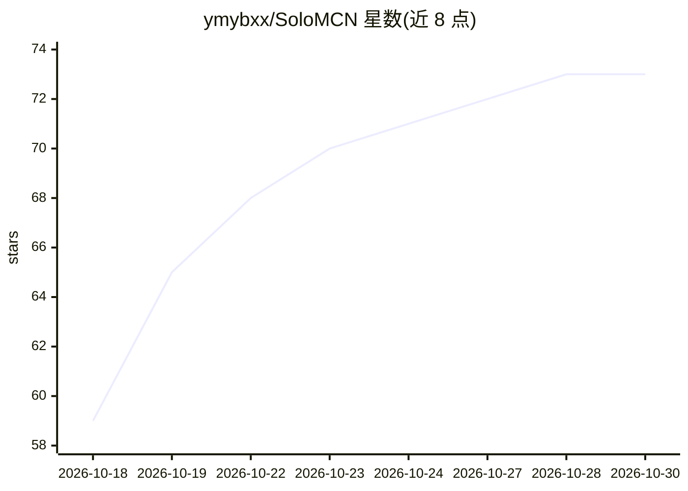

# ymybxx/SoloMCN

⭐ 73 · JavaScript · MIT · 推送 2026-10-16 · [GitHub](https://github.com/ymybxx/SoloMCN) · 个人维护 · 中文 README

**让 Claude Code 全程操刀短视频创作与多平台发布的工作台**

面向一人 MCN 场景的本地工作台：以 Claude Code 为执行者，覆盖从国内热榜/推特/YouTube/B站抓取素材、选题、带出处的调研、分镜脚本、配音字幕动画成片，到发布抖音/小红书/B站/YouTube/推特的流程。环节以标准 Claude Code 技能（SKILL.md）定义，可文字修改、改动可对比可撤回。需要 Mac 与 Claude 订阅，一键脚本安装依赖（Node/Python/ffmpeg/Chrome 等），提供 solomcn 命令与网页工作台；推特号池与自动发布存在账号风控风险，README 中有明确提示。

## 筛选速览

| 维度 | 判定 | 备注 |
|---|---|---|
| AI 角色 | `ai-native` | 本体是模型或模型工具 |
| 许可风险 | `permissive` | MIT |
| 部署形态 | `None` |  |
| 模型依赖 | locked-api |  |
| 硬件要求 | — | 无带数字的原话,不猜 |
| 安装摩擦 | `medium` | 含编译或系统依赖之一 |
| 成熟度 | — | 结构信号不足 |

## 能力要点

- 热榜/推特/YouTube/B站素材抓取到五平台发布的全流程 Claude Code 驱动
- 流程以 Claude Code 技能（SKILL.md）定义，改文字即改流程，改动可对比可撤回
- 支持多账号多系列矩阵、B站视频素材下载与爆款拆解
- curl 一键安装脚本与 solomcn 命令行启停

## 适用场景

- 一个人运营多个短视频账号，从选题到发布全流程交给 Claude
- 抓取推特与海外热点做国内信息差选题
- 对 YouTube 爆款视频做拆解并产出原创选题

## 场景标签

`视频生成` `网页抓取` · 领域:效率与自动化

## 证据(README 行号)

> L7: **Claude 是员工，SoloMCN 是它的工位：备好素材、沉淀做法、留你拍板。从热榜选题、动手调研、写分镜、做成片，到发抖音、小红书、B站、YouTube、推特，每一步都是 Claude 亲手做的。**
> L55: 工作台是 Claude 的工位，只做三件事：**备好素材**（热榜、推特、YouTube、B站定时抓好，带上你的登录），**管好经验和技能**（每个环节怎么做都写成标准的 Claude Code 技能，每次改动都能看对比、能撤回，
> L75: 每个箭头都是一次 Claude Code 运行，页面上实时看它每一步在做什么，跑到一半还能插话。你只在三处拍板：做哪个选题、成片行不行、发不发。

## 星数曲线

2026-10-18 59 → 2026-10-30 73（+14）

---
*卡片 v1 · prompt 1.4 · 生成 2026-10-24 · 置信度 high · 依据 README sha `7b9f44cb4e34` · [字段定义](../../DATASET.md)*
