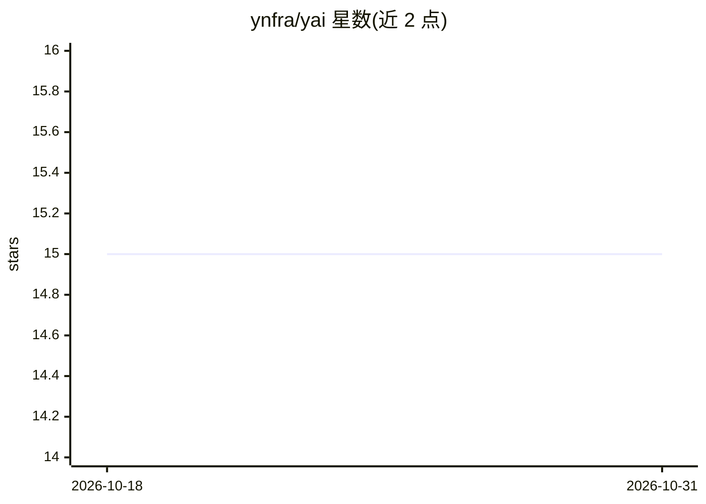

# ynfra/yai

⭐ 15 · Shell · MIT · 推送 2026-09-04 · [GitHub](https://github.com/ynfra/yai) · 个人维护

**自托管 Docker 化 AI 基础设施栈：单一 CLI 编排十余个服务**

基于 Docker Compose 的自托管 AI 基础设施集合，包含 LiteLLM 网关（远程推理代理，主机无 GPU）、Langfuse/Grafana/vmetrics 等观测组件、Qdrant 向量库、MinIO 对象存储、n8n/Windmill 工作流引擎、Firecrawl/browserless 抓取与浏览器舰队，由 Traefik 统一路由。所有服务为隔离的 docker-compose 项目，通过 ./yai.sh CLI 统一 init/start/logs/doctor 管理。前置要求 Docker Engine ≥ 24 与 Compose v2，需手动替换各服务 .env 中的占位密钥；Windmill 需绕过 CLI 用 docker compose 直接管理。

## 筛选速览

| 维度 | 判定 | 备注 |
|---|---|---|
| AI 角色 | `ai-ecosystem` | LLM/agent 周边工具 |
| 许可风险 | `permissive` | MIT |
| 部署形态 | `self-host` | docker 或自建部署 |
| 模型依赖 | — | README 未给出锁定关系 |
| 硬件要求 | — | 无带数字的原话,不猜 |
| 安装摩擦 | `low` | 无编译、无系统依赖或容器化 |
| 成熟度 | — | 结构信号不足 |

## 能力要点

- 单一 CLI（./yai.sh）管理全部 docker-compose 服务
- LiteLLM 网关代理远程推理，主机无 GPU
- Traefik 路由 *.yai.orb.local 并提供导航 dashboard
- 包含 LLM 网关、观测、向量库、对象存储、工作流引擎、浏览器舰队等组件

## 适用场景

- 本地/团队搭建一套自托管 AI 开发与观测基础设施
- 通过统一 CLI 启停和排查多个 AI 相关服务
- macOS 上用 OrbStack VM 运行整套栈用于开发

## 场景标签

 · 领域:AI 基础设施/自托管运维

## 证据(README 行号)

> L3: Self-hosted, docker-based AI infrastructure stack — LLM gateway, observability,
> L6: managed by a single CLI (`./yai.sh`); the host has no GPU — all inference is

## 星数曲线

2026-10-18 15 → 2026-10-31 15（+0）

---
*卡片 v1 · prompt 1.4 · 生成 2026-10-30 · 置信度 mid · 依据 README sha `f887be91e1eb` · [字段定义](../../DATASET.md)*
