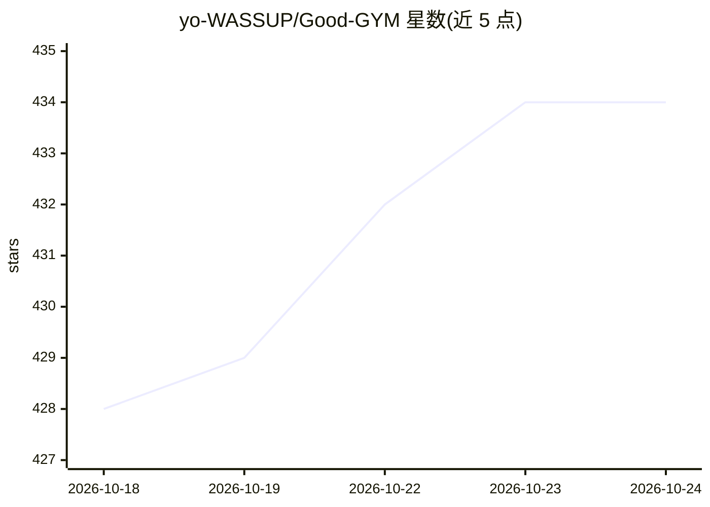

# yo-WASSUP/Good-GYM

⭐ 434 · Python · MIT · 推送 2026-07-02 · [GitHub](https://github.com/yo-WASSUP/Good-GYM) · 个人维护 · 中文 README

**面向健身者的实时姿态估计与动作计数应用**

本地运行的健身辅助应用：通过摄像头视频流用 RTMPose 做实时人体姿态检测，自动计数深蹲、俯卧撑、仰卧起坐及哑铃动作等多种训练，提供骨架可视化、角度测量与训练统计。默认 CPU 推理，可选 NVIDIA GPU 加速（仅源码运行，打包 EXE 仅支持 CPU）。训练类型以 data/exercises.json 配置，用户可不改代码添加自定义动作。提供 PyQt5 桌面版与 iOS 应用。

## 筛选速览

| 维度 | 判定 | 备注 |
|---|---|---|
| AI 角色 | `ai-native` | 本体是模型或模型工具 |
| 许可风险 | `permissive` | MIT |
| 部署形态 | `library` | 以包/库形式分发 |
| 模型依赖 | — | README 未给出锁定关系 |
| 硬件要求 | `cpu-ok` | |
| 安装摩擦 | `medium` | 含编译或系统依赖之一 |
| 成熟度 | — | 结构信号不足 |

## 能力要点

- RTMPose 实时姿态检测与自动动作计数
- 训练类型通过 data/exercises.json 配置，可自定义添加
- 默认 CPU 推理，本地运行，无需专用硬件，普通摄像头即可
- 提供 Windows 便携版可执行包与 iOS App

## 适用场景

- 在家训练时用摄像头自动计数深蹲、俯卧撑等动作
- 通过骨架与角度可视化检查动作幅度
- 添加自定义动作类型并跟踪训练统计

## 场景标签

`目标检测` · 领域:感知与多模态

## 证据(README 行号)

> L58: - **Real-time exercise counting** - Automatically counts your workout repetitions
> L60: - **Advanced pose detection** - Uses RTMPose for accurate tracking

## 星数曲线

2026-10-18 428 → 2026-10-24 434（+6）

---
*卡片 v1 · prompt 1.4 · 生成 2026-10-21 · 置信度 mid · 依据 README sha `f260a1a45052` · [字段定义](../../DATASET.md)*
