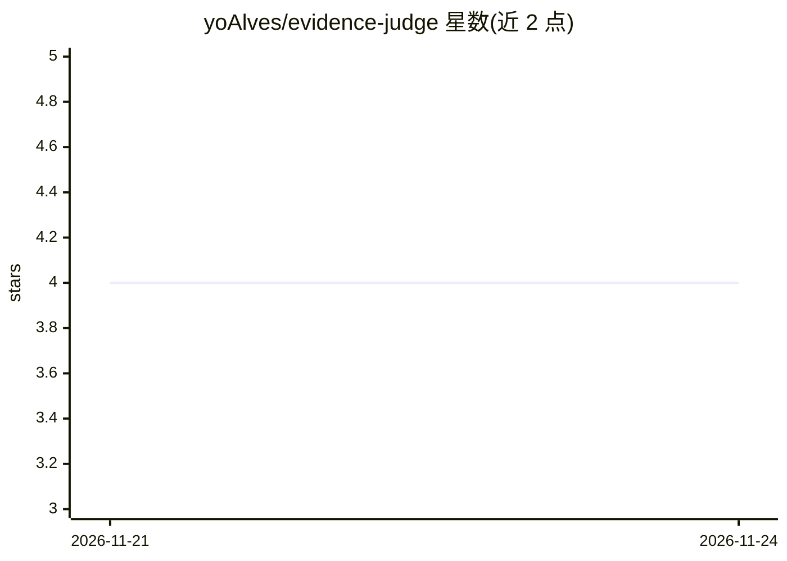

# yoAlves/evidence-judge

⭐ 4 · TypeScript · MIT · 推送 2026-11-19 · [GitHub](https://github.com/yoAlves/evidence-judge) · [官网](https://github.com/yoAlves/evidence-judge) · 个人维护

**OpenCode V2 证据优先研究插件：二元评审门控生成可溯源档案**

以 OpenCode V2 插件形式提供（一个 skill 加一条 /judge 命令），把研究问题转成仅由经核验摘录组成的 dossier.md。协议流程为：独立研究者采集带定位符的原文摘录、账本合并并记录冲突、2–5 个相互隔离的评审者审查账本、二元 PASS/FAIL 评审门（最多两次重试）裁决每条声明为事实、pending 或 excluded，编排者只转写决策。需 Git 与安装时网络访问；假定 POSIX shell，Windows 未测试；通过 git 规格固定版本分发，未发布 npm 注册表。

## 筛选速览

| 维度 | 判定 | 备注 |
|---|---|---|
| AI 角色 | `ai-native` | 本体是模型或模型工具 |
| 许可风险 | `permissive` | MIT |
| 部署形态 | `library` | 以包/库形式分发 |
| 模型依赖 | — | README 未给出锁定关系 |
| 硬件要求 | — | 无带数字的原话,不猜 |
| 安装摩擦 | `low` | 无编译、无系统依赖或容器化 |
| 成熟度 | `idea` | |

## 能力要点

- 无摘录即无声明：每条输出必须附原文引用与可再定位的 locator
- 二元评审门：仅 PASS/FAIL，最多两次重试，每轮换新评审
- 2–5 个隔离评审者，互不可见研究原始材料与他人意见
- 运行产物写入 mktemp 临时目录，用户项目不被改动

## 适用场景

- 从官方来源构建每条论断可溯源的研究档案
- 生成附证据引用的学习测验与问答材料
- 把无法溯源到真实摘录的内容标记为 pending 而非事实

## 场景标签

`科研工具` `多智能体` · 领域:Agent 开发

## 证据(README 行号)

> L15: thin OpenCode V2 plugin (a skill plus a command) that turns a study question into
> L21: It is built for studying and verifying claims, not for producing plausible text

## 星数曲线

2026-11-21 4 → 2026-11-24 4（+0）

---
*卡片 v1 · prompt 1.4 · 生成 2026-11-21 · 置信度 high · 依据 README sha `677834a45da4` · [字段定义](../../DATASET.md)*
