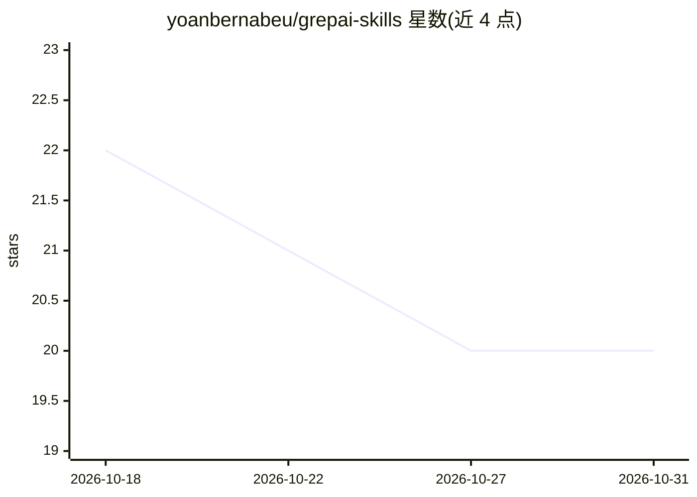

# yoanbernabeu/grepai-skills

⭐ 20 · MIT · 推送 2026-10-30 · [GitHub](https://github.com/yoanbernabeu/grepai-skills) · [官网](https://github.com/yoanbernabeu/grepai) · 个人维护

**GrepAI 语义代码搜索工具的 27 条 AI agent 技能合集**

为 GrepAI（基于本地嵌入 Ollama 的语义代码搜索与调用图分析工具）编写的 27 个 SKILL.md 格式 agent 技能，覆盖安装、配置、Ollama/OpenAI/LM Studio 嵌入配置、PostgreSQL/Qdrant 存储、索引、语义搜索技巧、调用链追踪、MCP 集成等主题，并按类别组成 9 个技能包。通过 npx skills add 一键安装到 Claude Code、Cursor、Codex 等 30+ AI agent 的技能目录，也可手动复制目录或经 Claude Code 插件市场安装。

## 筛选速览

| 维度 | 判定 | 备注 |
|---|---|---|
| AI 角色 | `ai-knowledge` | 知识聚合/清单类 |
| 许可风险 | `permissive` | MIT |
| 部署形态 | `library` | 以包/库形式分发 |
| 模型依赖 | local-ok | 支持本地模型 |
| 硬件要求 | — | 无带数字的原话,不猜 |
| 安装摩擦 | `low` | 无编译、无系统依赖或容器化 |
| 成熟度 | — | 结构信号不足 |

## 能力要点

- 27 个技能覆盖安装/配置/嵌入/存储/搜索/调用图/MCP 集成
- npx 一键安装，兼容 Claude Code、Cursor 等 30+ AI agent
- 按类别组织为 9 个技能包，含 27 技能完整包

## 适用场景

- 让我的 AI agent 掌握 GrepAI 的安装配置与搜索用法
- 在代码库中按语义查找与追踪函数调用链时获得技能指导
- 为 Claude Code / Cursor 等 agent 配置 GrepAI MCP 集成

## 场景标签

`语义搜索` · 领域:知识与检索

## 证据(README 行号)

> L8:  27 AI Agent Skills to master semantic code search with GrepAI.
> L44: Copy the `skills/` directory to:
> L45: - **Global**: `~/.claude/skills/` (or `~/.cursor/skills/`, etc.)

## 星数曲线

2026-10-18 22 → 2026-10-31 20（-2）

---
*卡片 v1 · prompt 1.4 · 生成 2026-10-28 · 置信度 high · 依据 README sha `29d5dc667497` · [字段定义](../../DATASET.md)*
