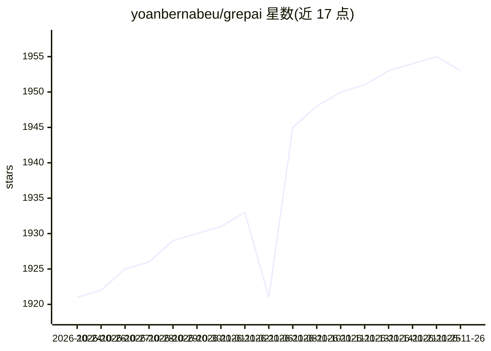

# yoanbernabeu/grepai

⭐ 1,953 · C · MIT · 推送 2026-11-02 · [GitHub](https://github.com/yoanbernabeu/grepai) · [官网](https://yoanbernabeu.github.io/grepai/) · 个人维护

**面向 AI 编码 agent 的本地语义代码搜索 CLI**

Go 编写的隐私优先 CLI：用向量嵌入对代码库建索引，支持自然语言语义搜索、调用图追踪（trace callers/callees）与文件监听自动更新索引；同时提供 MCP server 供 AI agent 作为工具直接调用，宣称可降低 agent 输入 token。100% 本地运行，代码不出机器。通过 Homebrew/脚本安装，需配置 embedding provider（默认 Ollama，也支持 LM Studio、OpenAI）。

## 筛选速览

| 维度 | 判定 | 备注 |
|---|---|---|
| AI 角色 | `ai-ecosystem` | LLM/agent 周边工具 |
| 许可风险 | `permissive` | MIT |
| 部署形态 | `None` |  |
| 模型依赖 | local-ok | 支持本地模型 |
| 硬件要求 | — | 无带数字的原话,不猜 |
| 安装摩擦 | `low` | 无编译、无系统依赖或容器化 |
| 成熟度 | — | 结构信号不足 |

## 能力要点

- 自然语言语义搜索：按意图（如 authentication logic）定位相关代码
- 调用图追踪：变更前查看函数的调用方
- MCP server 模式，agent 可将 grepai 作为工具调用
- 文件监听自动保持索引最新，全程本地运行

## 适用场景

- 给 Claude Code/Cursor 等编码 agent 提供语义检索上下文
- 重构前确认某函数被哪些代码调用
- 命名风格不统一的大代码库中按概念查找代码

## 场景标签

`语义搜索` · 领域:知识与检索

## 证据(README 行号)

> L17: `grepai` is a privacy-first CLI for semantic code search. It uses vector embeddings to understand code meaning, ena
> L27: - **AI agent ready** — Works with Claude Code, Cursor, Windsurf out of the box
> L28: - **MCP server** — Your AI agent can call grepai directly as a tool

## 星数曲线

2026-10-24 1,921 → 2026-11-26 1,953（+32）

---
*卡片 v1 · prompt 1.4 · 生成 2026-11-23 · 置信度 high · 依据 README sha `6c3ba31363c3` · [字段定义](../../DATASET.md)*
