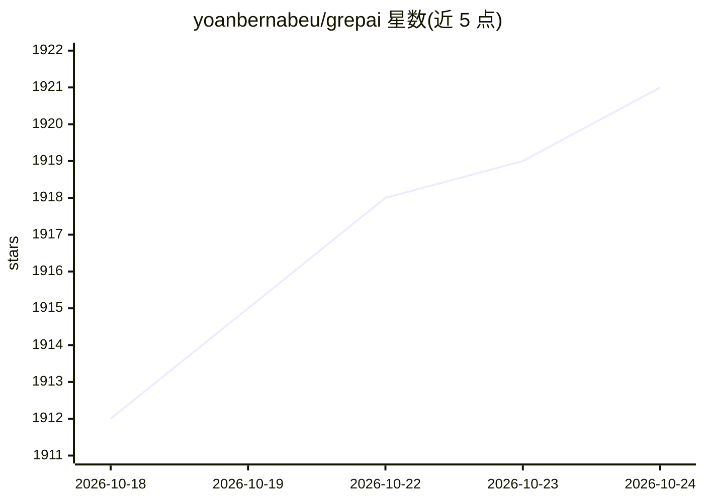

# yoanbernabeu/grepai

⭐ 1,921 · C · MIT · 推送 2026-09-21 · [GitHub](https://github.com/yoanbernabeu/grepai) · [官网](https://yoanbernabeu.github.io/grepai/) · 个人维护

**面向 AI 代理的本地语义代码搜索与调用图 CLI**

Go 编写的隐私优先 CLI 工具，用向量嵌入实现按语义（意图）搜索代码，支持自然语言查询与调用图追踪（trace callers）。索引通过文件监听守护进程自动更新，全程本地运行，代码不出本机。可配置为 MCP server，供 Claude Code、Cursor、Windsurf 等 AI 代理作为工具直接调用，目标是减少代理输入 token。嵌入需外部 provider：默认 Ollama，也可用 LM Studio 或 OpenAI。安装提供 Homebrew、curl 脚本与 PowerShell 三种途径，并支持多 shell 自动补全。

## 筛选速览

| 维度 | 判定 | 备注 |
|---|---|---|
| AI 角色 | `ai-ecosystem` | LLM/agent 周边工具 |
| 许可风险 | `permissive` | MIT |
| 部署形态 | `None` |  |
| 模型依赖 | local-ok | 支持本地模型 |
| 硬件要求 | — | 无带数字的原话,不猜 |
| 安装摩擦 | `low` | 无编译、无系统依赖或容器化 |
| 成熟度 | — | 结构信号不足 |

## 能力要点

- 向量嵌入语义搜索，自然语言查询定位代码
- 调用图追踪（trace callers）
- 100% 本地运行，文件监听自动更新索引
- 可作为 MCP server 被 AI 代理直接调用

## 适用场景

- 用自然语言在代码库中查找概念相关代码
- 改动函数前追踪谁调用了它
- 为 Claude Code/Cursor 等代理提供精简上下文以减少 token 消耗

## 场景标签

`语义搜索` · 领域:知识与检索

## 证据(README 行号)

> L17: `grepai` is a privacy-first CLI for semantic code search. It uses vector embeddings to understand code meaning, ena
> L27: - **AI agent ready** — Works with Claude Code, Cursor, Windsurf out of the box
> L28: - **MCP server** — Your AI agent can call grepai directly as a tool

## 星数曲线

2026-10-18 1,912 → 2026-10-24 1,921（+9）

---
*卡片 v1 · prompt 1.4 · 生成 2026-10-21 · 置信度 high · 依据 README sha `fa4f272c7d0e` · [字段定义](../../DATASET.md)*
