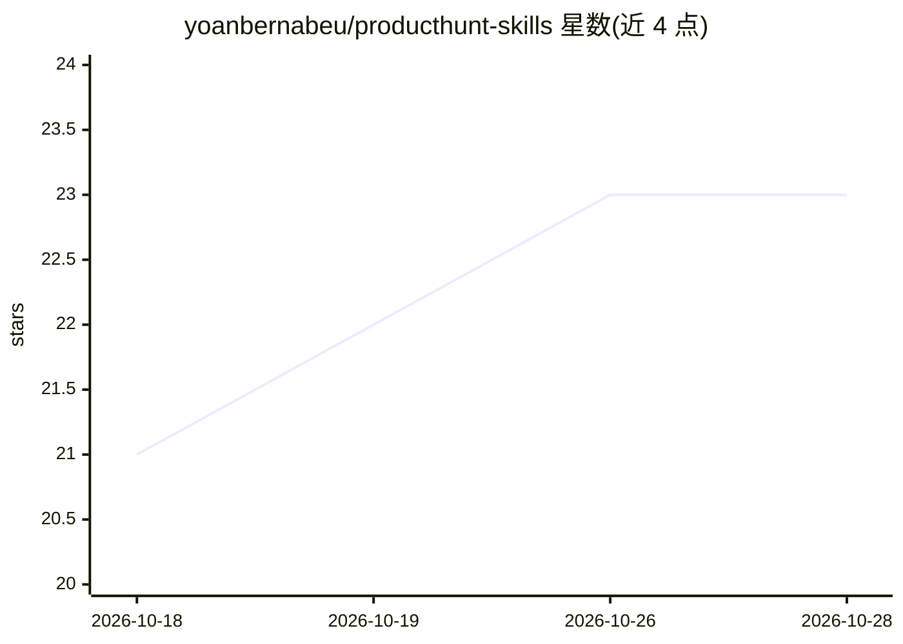

# yoanbernabeu/producthunt-skills

⭐ 23 · MIT · 推送 2026-01-30 · [GitHub](https://github.com/yoanbernabeu/producthunt-skills) · 个人维护

**31 个 Product Hunt 发布向 AI Agent 技能包**

为 AI Agent 提供的技能集合：收录 31 个 SKILL.md 格式的 Product Hunt 发布技能，覆盖发布策略、文案创作、营销触达、发布日执行、合规防封禁、猎手寻找、定价、分析与发布后跟进等类别。可通过 npx skills add 一键安装，或 Claude Code 插件市场、手动复制 skills/ 目录三种方式安装，声明兼容 Claude Code、Cursor、Codex、OpenCode、Windsurf 等 30+ Agent，并提供按类别打包的 Skill Packs 与 6 步快速上手指南。

## 筛选速览

| 维度 | 判定 | 备注 |
|---|---|---|
| AI 角色 | `ai-knowledge` | 知识聚合/清单类 |
| 许可风险 | `permissive` | MIT |
| 部署形态 | `library` | 以包/库形式分发 |
| 模型依赖 | — | README 未给出锁定关系 |
| 硬件要求 | — | 无带数字的原话,不猜 |
| 安装摩擦 | `low` | 无编译、无系统依赖或容器化 |
| 成熟度 | — | 结构信号不足 |

## 能力要点

- 31 个技能覆盖策略/内容/营销/合规/分析/发布后 11 个类别
- npx skills add 一键安装，另有 Claude Code 插件市场与手动复制两种方式
- 声明兼容 Claude Code、Cursor、Codex、OpenCode、Windsurf 等 30+ Agent
- 提供 10 个按类别打包的 Skill Packs

## 适用场景

- 让我的 AI Agent 给出 Product Hunt 发布日的执行清单
- 为我的 SaaS 产品生成 Product Hunt 标语和描述文案
- 发布前检查触犯 Product Hunt 规则被封禁的风险

## 场景标签

`AI 写作` `提示工程` · 领域:Agent 开发

## 证据(README 行号)

> L8:  31 AI Agent Skills to launch your product on Product Hunt like a pro.
> L63: |Skill|What It Does|
> L153: |Agent|Project Path|Global Path|

## 星数曲线

2026-10-18 21 → 2026-10-28 23（+2）

---
*卡片 v1 · prompt 1.4 · 生成 2026-10-27 · 置信度 high · 依据 README sha `0ded994e21eb` · [字段定义](../../DATASET.md)*
