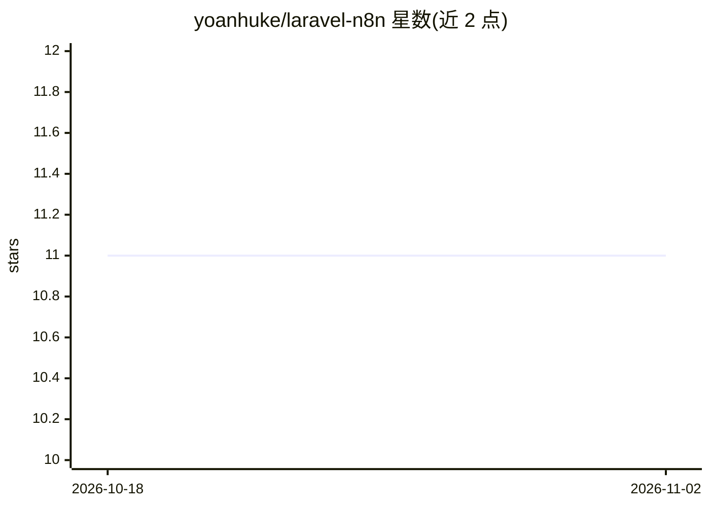

# yoanhuke/laravel-n8n

⭐ 11 · PHP · MIT · 推送 2026-10-13 · [GitHub](https://github.com/yoanhuke/laravel-n8n) · 个人维护

**Laravel 应用调用 n8n REST API 与 Webhook 的客户端包**

PHP Composer 包，为 Laravel 提供访问 n8n 公开 REST API 的 Fluent 门面（N8N），支持触发工作流、获取/列出/删除工作流，以及从 Laravel 路由接收 n8n Webhook 回调。使用前需发布配置文件并填入 n8n API key 与端点。面向在 Laravel 应用中编排 n8n 自动化流程的开发者。注意：README 中多处将配置文件路径写为指向 GitHub 仓库 zip 包的 URL（L36/L42/L47/L64），与常规本地 config 文件路径描述不一致。

## 筛选速览

| 维度 | 判定 | 备注 |
|---|---|---|
| AI 角色 | `ai-ecosystem` | LLM/agent 周边工具 |
| 许可风险 | `permissive` | MIT |
| 部署形态 | `None` |  |
| 模型依赖 | — | README 未给出锁定关系 |
| 硬件要求 | — | 无带数字的原话,不猜 |
| 安装摩擦 | `low` | 无编译、无系统依赖或容器化 |
| 成熟度 | — | 结构信号不足 |

## 能力要点

- N8N 门面提供 trigger/getWorkflow/listWorkflows/deleteWorkflow 方法
- 支持从 Laravel 路由处理 n8n Webhook 回调
- 通过 vendor:publish 发布配置，填入 API key 与端点即可使用

## 适用场景

- 在 Laravel 应用中触发 n8n 工作流完成邮件通知等自动化
- 通过 Webhook 接收 n8n 事件回调并联动应用逻辑
- 用代码管理 n8n 工作流（列出/获取/删除）

## 场景标签

 · 领域:自动化/开发集成

## 证据(README 行号)

> L12: Laravel N8N is a complete, expressive, and fluent Laravel client designed for the n8n public REST API and Webhooks 
> L17: - **Webhook Support**: Trigger workflows through webhooks directly from your Laravel application.

## 星数曲线

2026-10-18 11 → 2026-11-02 11（+0）

---
*卡片 v1 · prompt 1.4 · 生成 2026-11-01 · 置信度 high · 依据 README sha `fc4b8aa78a1a` · [字段定义](../../DATASET.md)*
