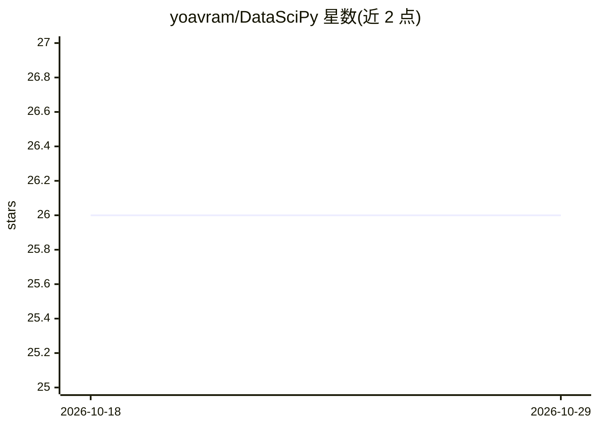

# yoavram/DataSciPy

⭐ 26 · Jupyter Notebook · 推送 2026-09-30 · [GitHub](https://github.com/yoavram/DataSciPy) · 个人维护

**Python 深度学习研讨会材料：Jupyter 讲义与环境配置**

由 Yoav Ram 维护的 Deep Learning with Python 研讨会仓库，包含以 index.ipynb 为目录的系列 Jupyter 讲义笔记本，主题标签涉及 JAX、Keras、NumPy、pandas、scikit-learn 等科学计算与机器学习库。安装方式为下载 ZIP（或 git clone 仓库），用 Miniforge 提供的 mamba 按 environment.yml 更新环境，再通过 Jupyter Lab 或 VS Code 打开笔记本运行。面向研讨会参与者，属教程/知识类内容而非软件产品。

## 筛选速览

| 维度 | 判定 | 备注 |
|---|---|---|
| AI 角色 | `ai-knowledge` | 知识聚合/清单类 |
| 许可风险 | `none` | — |
| 部署形态 | `None` |  |
| 模型依赖 | — | README 未给出锁定关系 |
| 硬件要求 | — | 无带数字的原话,不猜 |
| 安装摩擦 | `low` | 无编译、无系统依赖或容器化 |
| 成熟度 | — | 结构信号不足 |

## 能力要点

- 以 index.ipynb 组织的研讨会讲义笔记本
- 提供 environment.yml 一键配置 Python 依赖环境
- 支持 Jupyter Lab 与 VS Code 两种使用方式

## 适用场景

- 跟随研讨会学习 Python 深度学习
- 在本地复现讲义中的代码环境

## 场景标签

`教程课程` · 领域:学习与行业

## 证据(README 行号)

> L1: # Deep Learning with Python workshop
> L4: Go to the index notebook to view the table of contents.

## 星数曲线

2026-10-18 26 → 2026-10-29 26（+0）

---
*卡片 v1 · prompt 1.4 · 生成 2026-10-26 · 置信度 high · 依据 README sha `d3fb5fcd92cb` · [字段定义](../../DATASET.md)*
