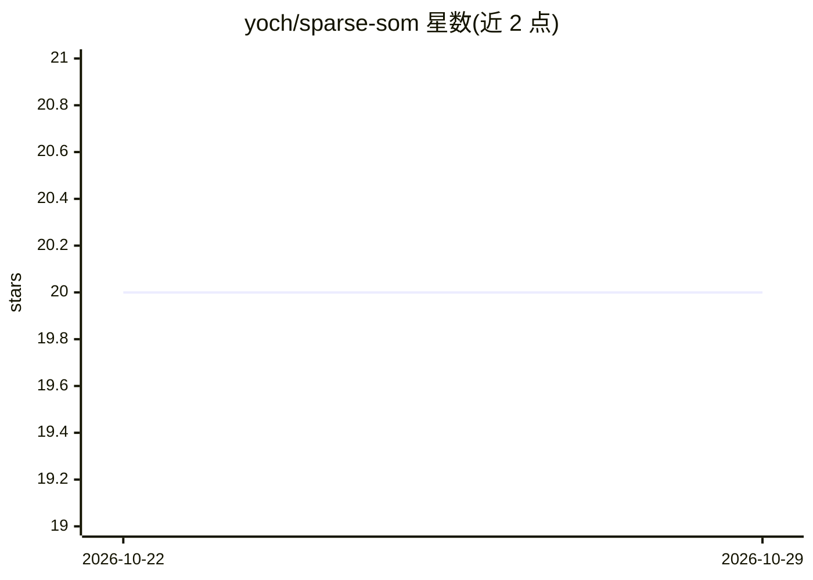

# yoch/sparse-som

⭐ 20 · C++ · GPL-3.0 · 推送 2026-10-20 · [GitHub](https://github.com/yoch/sparse-som) · [官网](https://sparse-som.readthedocs.io/) · 个人维护

**面向稀疏高维数据的自组织映射（SOM）C++/Python 实现**

Kohonen 自组织映射（SOM）的效率导向实现：针对稀疏高维数据（如文本，LIBSVM 格式）设计专用算法，时间复杂度仅取决于非零值。提供 online 与 batch 两种算法，batch 版用 OpenMP 并行。以 C++ 命令行工具（源码 make 编译，无需安装）和 Python 包（pip 安装）两种形式提供；示例使用 scikit-learn 的 digits 数据。C++ API 尚未公开（接口仍可能变动）。GPL v3 许可。

## 筛选速览

| 维度 | 判定 | 备注 |
|---|---|---|
| AI 角色 | `ai-native` | 本体是模型或模型工具 |
| 许可风险 | `viral` | GPL-3.0 |
| 部署形态 | `library` | 以包/库形式分发 |
| 模型依赖 | — | README 未给出锁定关系 |
| 硬件要求 | — | 无带数字的原话,不猜 |
| 安装摩擦 | `medium` | 含编译或系统依赖之一 |
| 成熟度 | — | 结构信号不足 |

## 能力要点

- 针对稀疏数据的专用 SOM 算法，复杂度仅取决于非零值
- online 与 batch 两种算法，batch 版 OpenMP 并行
- C++ 命令行工具与 Python API 双形态
- 输入为 LIBSVM 稀疏格式，标签用于网络校准

## 适用场景

- 对高维稀疏文本特征做 SOM 聚类与降维可视化
- 在 Python 流程中用 pip 安装即用稀疏 SOM
- 用命令行批量处理 LIBSVM 格式数据

## 场景标签

 · 领域:机器学习/聚类

## 证据(README 行号)

> L7: Efficient implementation of the Self-Organizing Map (SOM, Kohonen map) for sparse, high-dimensional data (e.g. text)
> L17: - Support both online and batch SOM algorithms.

## 星数曲线

2026-10-22 20 → 2026-10-29 20（+0）

---
*卡片 v1 · prompt 1.4 · 生成 2026-10-28 · 置信度 high · 依据 README sha `f16ad2d5b616` · [字段定义](../../DATASET.md)*
