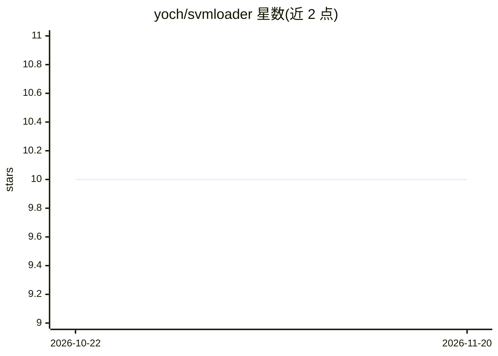

# yoch/svmloader

⭐ 10 · Python · GPL-3.0 · 推送 2026-10-20 · [GitHub](https://github.com/yoch/svmloader) · [官网](https://svmloader.readthedocs.io/) · 个人维护

**给 Python ML 用户的 libsvm/svmlight 稀疏数据快速加载库**

用 Cython 实现的 libsvm / svmlight 格式数据文件加载器，读取后输出 scipy.sparse.csr_matrix 数据矩阵与 numpy 标签数组；支持 .gz / .bz2 压缩文件在线解压、int/float 标签、float32/float64 数据类型。定位为 sklearn.datasets.load_svmlight_file 的替代实现，但不支持 query_id 且 dtype 受限。通过 pip 安装，依赖 numpy 与 scipy，README 附与 scikit-learn 的基准测试对比。

## 筛选速览

| 维度 | 判定 | 备注 |
|---|---|---|
| AI 角色 | `ai-ecosystem` | LLM/agent 周边工具 |
| 许可风险 | `viral` | GPL-3.0 |
| 部署形态 | `library` | 以包/库形式分发 |
| 模型依赖 | — | README 未给出锁定关系 |
| 硬件要求 | — | 无带数字的原话,不猜 |
| 安装摩擦 | `low` | 无编译、无系统依赖或容器化 |
| 成熟度 | — | 结构信号不足 |

## 能力要点

- Cython 实现，输出 scipy.sparse.csr_matrix 与 numpy 标签数组
- 支持 .gz / .bz2 压缩文件在线解压
- README 提供与 scikit-learn load_svmlight_file 的基准测试数据
- 支持 int/float 标签与 float32/float64 数据类型

## 适用场景

- 加载 libsvm 格式的大规模稀疏数据集用于机器学习训练
- 用 Python 管道直接读取 gz/bz2 压缩的 svmlight 文件

## 场景标签

 · 领域:机器学习/数据加载工具

## 证据(README 行号)

> L6: Fast loader for libsvm / svmlight sparse data files in Python (Cython),
> L7: an alternative to `sklearn.datasets.load_svmlight_file`.
> L27: - numpy

## 星数曲线

2026-10-22 10 → 2026-11-20 10（+0）

---
*卡片 v1 · prompt 1.4 · 生成 2026-11-19 · 置信度 high · 依据 README sha `d881ba23ca7b` · [字段定义](../../DATASET.md)*
