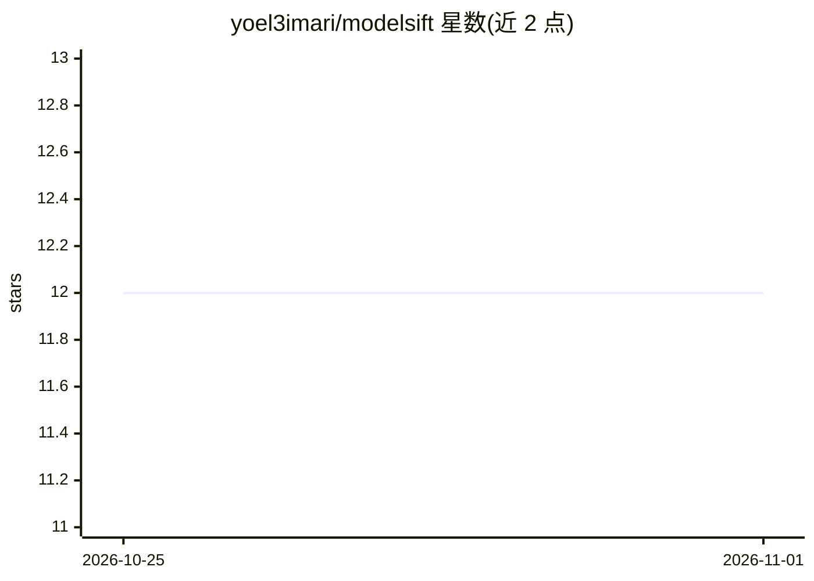

# yoel3imari/modelsift

⭐ 12 · TypeScript · GPL-3.0 · 推送 2026-10-25 · [GitHub](https://github.com/yoel3imari/modelsift) · 个人维护

**本地开源权重 LLM 选型与运行桌面工具：先算显存再下载**

基于 Tauri 2 / Rust / React 19 的跨平台桌面应用，面向想在本地运行开源权重 LLM 的用户。它读取本机硬件（Apple Silicon 统一内存、NVIDIA/AMD GPU 或 CPU RAM），按权重+KV cache+开销计算模型是否放得下，给出 Fits/Tight Fit/Exceeds Limits 判定；随后从 HuggingFace Hub 下载经 SHA-256 与 GGUF 头校验的文件，托管 llama-server sidecar，并通过 OpenAI 兼容 API（127.0.0.1:13370/v1）对外提供聊天与 embedding 服务。预构建安装器要求 Linux glibc 2.39+ / macOS 15+，旧系统需源码构建。

## 筛选速览

| 维度 | 判定 | 备注 |
|---|---|---|
| AI 角色 | `ai-ecosystem` | LLM/agent 周边工具 |
| 许可风险 | `viral` | GPL-3.0 |
| 部署形态 | `desktop` | 安装包/桌面程序 |
| 模型依赖 | local-ok | 支持本地模型 |
| 硬件要求 | — | 无带数字的原话,不猜 |
| 安装摩擦 | `medium` | 含编译或系统依赖之一 |
| 成熟度 | — | 结构信号不足 |

## 能力要点

- GQA KV cache 实时内存适配计算（2K–32K+ 上下文、GPU offload 层数）
- HuggingFace Hub 多流断点续传下载 + SHA-256 与 GGUF 头校验
- 托管 llama-server sidecar 并暴露 OpenAI 兼容网关（chat + embeddings）
- macOS(Metal)/Linux(AVX2)/Windows 跨平台，核心二进制约 13 MB

## 适用场景

- 下载前确认某模型能否在我这台机器上跑起来
- 给 Cursor、Cline、Aider 等编码工具接一个本地 OpenAI 兼容端点
- 本地同时运行聊天与 embedding 模型并通过 model 字段路由

## 场景标签

`推理引擎` · 领域:训练与推理

## 证据(README 行号)

> L32: ModelSift exists to take that guesswork out. It's a small, fast desktop app built with **Tauri 2**, **Rust**, and *
> L43: * **It manages the server for you:** Spawns and watches the `llama-server` sidecar, waits for it to become healthy,

## 星数曲线

2026-10-25 12 → 2026-11-01 12（+0）

---
*卡片 v1 · prompt 1.4 · 生成 2026-10-31 · 置信度 mid · 依据 README sha `73e5eef510ce` · [字段定义](../../DATASET.md)*
