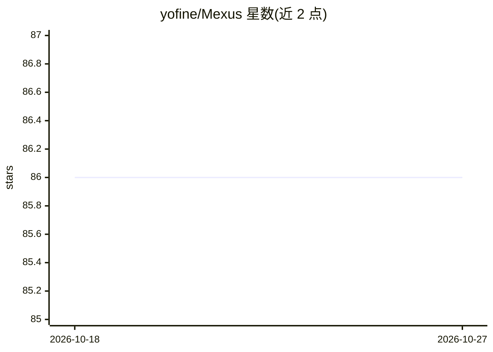

# yofine/Mexus

⭐ 86 · TypeScript · Apache-2.0 · 推送 2026-09-03 · [GitHub](https://github.com/yofine/Mexus) · [官网](https://mexus.ai) · 个人维护

**本地 Web 控制台，并行管理多个 CLI AI Agent 实例**

面向使用 CLI AI Agent（Claude Code、OpenCode、Aider、Codex、Gemini）的开发者的本地 Web 执行层：以受管终端面板形式创建、关闭、重启和恢复多个 agent 执行，实时显示运行状态；每个 agent 可在独立 Git worktree 中工作以避免分支冲突。运行时观测自动解析 Claude Code 状态栏，显示模型名、上下文占用、累计成本与 session ID；另提供统一文件树、代码查看器、Git diff 面板与命令面板。配置采用 YAML（全局与项目级）。通过 npm 全局安装 mexus-cli 使用。

## 筛选速览

| 维度 | 判定 | 备注 |
|---|---|---|
| AI 角色 | `ai-ecosystem` | LLM/agent 周边工具 |
| 许可风险 | `permissive` | Apache-2.0 |
| 部署形态 | `library` | 以包/库形式分发 |
| 模型依赖 | — | README 未给出锁定关系 |
| 硬件要求 | — | 无带数字的原话,不猜 |
| 安装摩擦 | `low` | 无编译、无系统依赖或容器化 |
| 成熟度 | — | 结构信号不足 |

## 能力要点

- 以终端面板并行管理 Claude Code/OpenCode/Aider/Codex/Gemini 五种 CLI agent
- 每个 agent 在独立 Git worktree 中工作，支持并行分支开发
- 解析 Claude Code statusline，实时显示模型、上下文占用、成本与 session ID
- 统一审查面板：文件树、Shiki 代码查看、Git diff

## 适用场景

- 同时运行多个 AI agent 处理不同任务并监控其状态
- 在隔离的 Git worktree 中让多个 agent 并行改代码
- 从一个控制台集中审查各 agent 的文件变更与 diff

## 场景标签

`多智能体` · 领域:Agent 开发

## 证据(README 行号)

> L5: Mexus is the execution layer for multi-agent development. It turns scattered CLI AI agents into a unified local syst
> L12: - Supports multiple agents: Claude Code, OpenCode, Aider, Codex, Gemini

## 星数曲线

2026-10-18 86 → 2026-10-27 86（+0）

---
*卡片 v1 · prompt 1.4 · 生成 2026-10-23 · 置信度 high · 依据 README sha `179a6d383152` · [字段定义](../../DATASET.md)*
