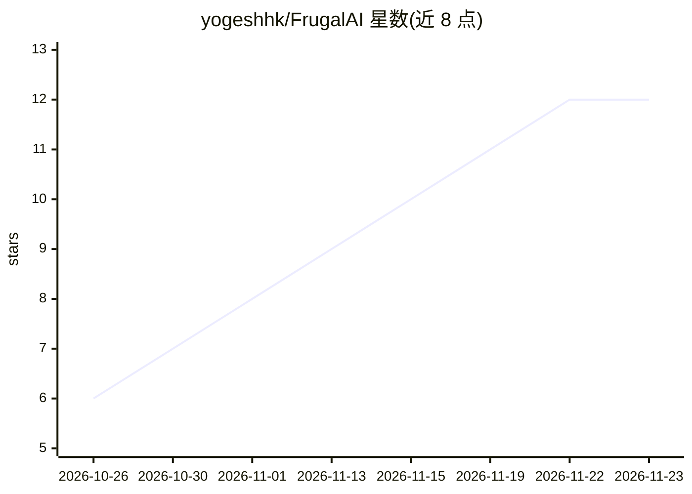

# yogeshhk/FrugalAI

⭐ 12 · Python · MIT · 推送 2026-11-22 · [GitHub](https://github.com/yogeshhk/FrugalAI) · 个人维护

**在旧笔记本与树莓派上运行的低成本本地 AI 应用与配方集**

面向印度农村等低资源场景的开源项目集合，每个项目为独立文件夹，覆盖离线笔记问答、马拉地语/印地语语音填表、LangGraph 工作流、CPU 上 LoRA 微调小模型等；提供统一的 Ollama/LM Studio 接口、基准测量命令与逐设备实测表格。约定 GPU 非必需、运行时无云端调用，每个数字须标注设备、版本与日期。environment.yml 尚未构建测试。

## 筛选速览

| 维度 | 判定 | 备注 |
|---|---|---|
| AI 角色 | `ai-native` | 本体是模型或模型工具 |
| 许可风险 | `permissive` | MIT |
| 部署形态 | `None` |  |
| 模型依赖 | local-ok | 支持本地模型 |
| 硬件要求 | `cpu-ok` | |
| 安装摩擦 | `low` | 无编译、无系统依赖或容器化 |
| 成熟度 | `idea` | |

## 能力要点

- 六个语言/语音与视觉项目，含离线 RAG、语音填表与工作流 agent
- code/common/ 提供 Ollama 与 LM Studio 的统一接口及基准命令
- What runs where 表格记录逐设备的 tokens/s 与峰值内存
- 项目分级体系：规则/经典 ML/小视觉/小语音/小语言模型

## 适用场景

- 在无 GPU 的旧笔记本上离线跑本地小模型问答
- 为马拉地语/印地语场景做离线语音表单录入
- 测量某个小模型在自己设备上的速度与内存
- 学生按模板复制项目文件夹做本地化改造

## 场景标签

`Agent 框架` `RAG` `微调` · 领域:Agent 开发

## 证据(README 行号)

> L5: FrugalAI is a collection of specific, working AI applications and the evidence behind them. Each one runs on the
> L52: |code/wiki-rag/|Offline questions and answers over a folder of notes (hand-built BM25 retrieval, own evaluation)|bu
> L54: |code/voice-form/|Speak a form in Marathi or Hindi (ASHA visit, enumeration, service ticket); offline speech to tex

## 星数曲线

2026-10-26 6 → 2026-11-23 12（+6）

---
*卡片 v1 · prompt 1.4 · 生成 2026-11-19 · 置信度 high · 依据 README sha `e4d1242b0fe1` · [字段定义](../../DATASET.md)*
