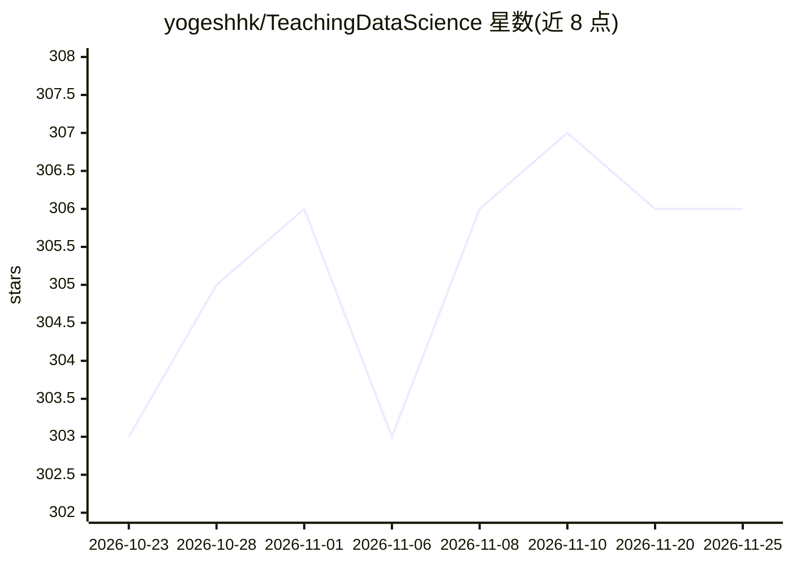

# yogeshhk/TeachingDataScience

⭐ 306 · Jupyter Notebook · MIT · 推送 2026-11-19 · [GitHub](https://github.com/yogeshhk/TeachingDataScience) · 个人维护

**面向师生学者的免费开源 AI 与数据科学 LaTeX 课程讲义**

以 LaTeX Beamer 组织的 AI 与数据科学教学资料仓库，含五门完整课程（约 40 小时）及数十个独立 workshop 与 seminar，主题覆盖机器学习、深度学习、NLP、GenAI、数学基础与 Python。每份源文件可同时编译为幻灯片和双栏速查表；`Code/` 目录提供可运行的 Python/notebook 项目，每个项目带 conda environment.yml 与 pytest 测试。需自行安装 LaTeX 发行版编译 PDF。MIT 许可，欢迎通过 CONTRIBUTING.md 贡献。

## 筛选速览

| 维度 | 判定 | 备注 |
|---|---|---|
| AI 角色 | `ai-knowledge` | 知识聚合/清单类 |
| 许可风险 | `permissive` | MIT |
| 部署形态 | `None` |  |
| 模型依赖 | — | README 未给出锁定关系 |
| 硬件要求 | — | 无带数字的原话,不猜 |
| 安装摩擦 | `low` | 无编译、无系统依赖或容器化 |
| 成熟度 | — | 结构信号不足 |

## 能力要点

- 课程/工作坊/研讨三级深度组织的教学内容
- 同一 .tex 源编译出幻灯片与速查表两种输出
- Code/ 目录提供带 environment.yml 与 pytest 的可运行项目

## 适用场景

- 为高校或企业内训挑选完整 AI/ML 课程或单场讲座材料
- 编译 PDF 幻灯片直接用于课堂教学
- 运行配套 notebook 复现 RAG、微调、GNN 等示例代码

## 场景标签

`教程课程` · 领域:学习与行业

## 证据(README 行号)

> L3:  Free, open-source Beamer slide decks and code for Machine Learning, Deep Learning, NLP, Generative AI, Maths for ML
> L24: - **Courses** (full curriculum, ~1-2 weeks / ~40 hrs): Machine Learning, Deep Learning, Generative AI, Maths for ML
> L38: `Code/` has runnable Python/notebook projects: GenAI and agents, RAG applications, fine-tuning, document parsing, d

## 星数曲线

2026-10-23 303 → 2026-11-25 306（+3）

---
*卡片 v1 · prompt 1.4 · 生成 2026-11-25 · 置信度 high · 依据 README sha `faa78ddbe762` · [字段定义](../../DATASET.md)*
