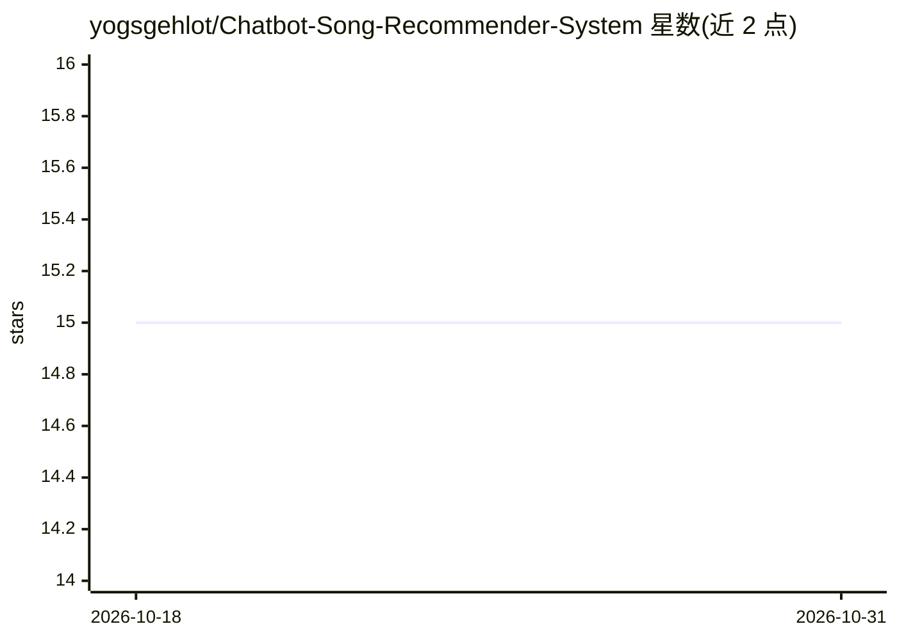

# yogsgehlot/Chatbot-Song-Recommender-System

⭐ 15 · Python · 推送 2026-08-12 · [GitHub](https://github.com/yogsgehlot/Chatbot-Song-Recommender-System) · 个人维护

**对话式 AI 音乐推荐系统：多轮聊天提取偏好并推荐歌曲**

基于 FastAPI 与 LangGraph 的端到端对话式歌曲推荐系统：通过多轮对话用 LLM（Gemini/OpenAI/Anthropic）提取用户情绪、节奏、语言等偏好，结合 TF-IDF 与余弦相似度的混合内容推荐引擎打分排序，并为每首推荐歌曲生成 LLM 解释。支持 Spotify 与 iTunes API 实时获取曲目（含无 key 的 iTunes 免费回退），或使用内置 204 首歌的 CSV 目录；会话内点赞/点踩反馈会影响后续打分。提供 Docker Compose 部署与前端玻璃拟态界面。项目声明用于教育与作品集目的。

## 筛选速览

| 维度 | 判定 | 备注 |
|---|---|---|
| AI 角色 | `ai-native` | 本体是模型或模型工具 |
| 许可风险 | `none` | — |
| 部署形态 | `self-host` | docker 或自建部署 |
| 模型依赖 | — | README 未给出锁定关系 |
| 硬件要求 | — | 无带数字的原话,不猜 |
| 安装摩擦 | `low` | 无编译、无系统依赖或容器化 |
| 成熟度 | — | 结构信号不足 |

## 能力要点

- LangGraph 有状态多轮对话工作流（意图分类、偏好提取、排序、解释）
- 混合内容推荐：TF-IDF + 余弦相似度 + 会话反馈权重
- Spotify/iTunes 双 API 接入，无 Spotify key 时回退到免费 iTunes Search
- Docker Compose 容器化部署，附 pytest 测试套件

## 适用场景

- 通过对话描述心情和偏好获取歌曲推荐
- 在会话中通过点赞点踩调整推荐结果
- 了解 LangGraph + FastAPI 构建对话式 agent 的工程实现

## 场景标签

`聊天机器人` `推荐系统` · 领域:对话与助手

## 证据(README 行号)

> L9: An end-to-end Agentic AI Music Recommendation & Chatbot system that uses FastAPI, LangGraph stateful conversation wo
> L31: * **LangGraph:** Stateful multi-turn conversation orchestrator
> L88: * **LangGraph Cognitive Flow:** Intent classification, extraction, retrieve candidates, rank, explain, and respond.

## 星数曲线

2026-10-18 15 → 2026-10-31 15（+0）

---
*卡片 v1 · prompt 1.4 · 生成 2026-10-30 · 置信度 mid · 依据 README sha `f2392ba8ae41` · [字段定义](../../DATASET.md)*
