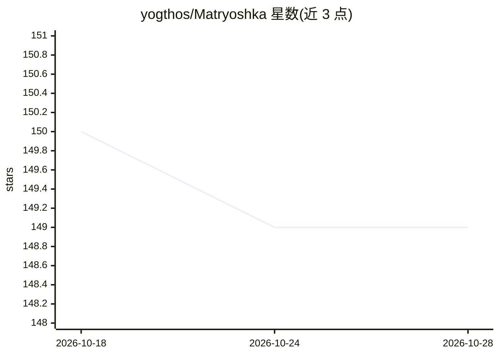

# yogthos/Matryoshka

⭐ 149 · TypeScript · Apache-2.0 · 推送 2026-05-17 · [GitHub](https://github.com/yogthos/Matryoshka) · 个人维护

**MCP 服务器：让 LLM 用符号命令分析超出上下文窗口的大文档**

基于 Recursive Language Models 论文实现的文档分析工具：LLM 输出受限的 S 表达式 DSL（Nucleus）命令，由 Lattice 逻辑引擎解析、类型检查并执行，替代 RAG/分块方案处理远超上下文窗口的文档。结果存入内存 SQLite（FTS5 索引），LLM 只接收句柄存根，宣称 97%+ token 节省；另提供跨会话 memo 上下文存储。支持 MCP sampling 协议的 llm_query、递归 rlm_query/rlm_batch、资源限制与多文档加载。提供 npm 包、npx 直接运行与源码构建三种途径，附 CLI、MCP 服务器、REPL、HTTP 等多个工具。

## 筛选速览

| 维度 | 判定 | 备注 |
|---|---|---|
| AI 角色 | `ai-ecosystem` | LLM/agent 周边工具 |
| 许可风险 | `permissive` | Apache-2.0 |
| 部署形态 | `library` | 以包/库形式分发 |
| 模型依赖 | local-ok | 支持本地模型 |
| 硬件要求 | — | 无带数字的原话,不猜 |
| 安装摩擦 | `low` | 无编译、无系统依赖或容器化 |
| 成熟度 | — | 结构信号不足 |

## 能力要点

- LLM 输出 Nucleus DSL 命令，由 Lattice 引擎解析/类型检查/安全执行
- 句柄式结果存储于 SQLite，LLM 接收存根而非全量数据
- lattice_memo 跨消息上下文存储与 LRU 淘汰
- 提供 rlm-mcp / lattice-mcp / lattice-repl / lattice-http 等多个 CLI 工具

## 适用场景

- 通过 MCP 让编码 agent 分析超出上下文窗口的大文件
- 对日志/文档做 grep、过滤、聚合等查询并节省 token
- 为长会话 agent 提供服务端上下文记忆

## 场景标签

`Agent 记忆` · 领域:Agent 开发

## 证据(README 行号)

> L6: Process documents 100x larger than your LLM's context window—without vector databases or chunking heuristics.
> L217: |`rlm-mcp`|MCP server with full RLM + LLM orchestration (`analyze_document` tool)|

## 星数曲线

2026-10-18 150 → 2026-10-28 149（-1）

---
*卡片 v1 · prompt 1.4 · 生成 2026-10-23 · 置信度 high · 依据 README sha `8220fd2d69f4` · [字段定义](../../DATASET.md)*
