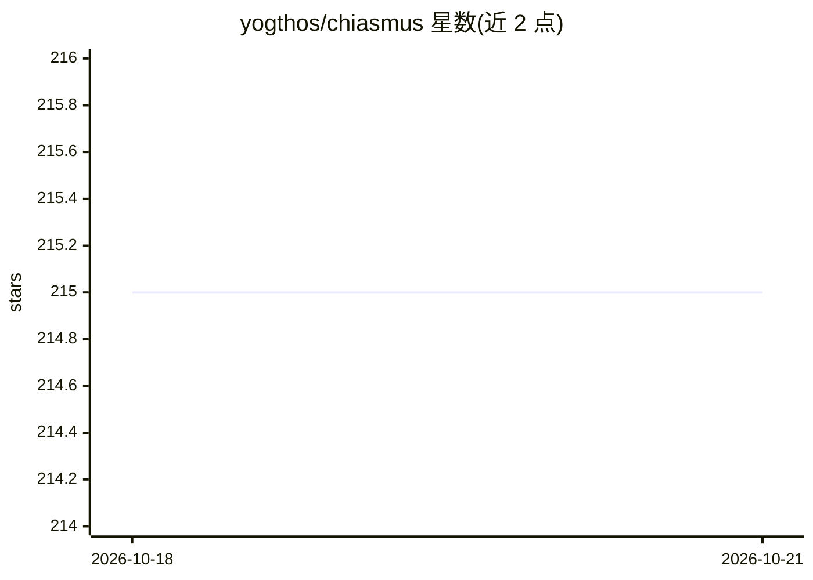

# yogthos/chiasmus

⭐ 218 · TypeScript · Apache-2.0 · 推送 2026-10-18 · [GitHub](https://github.com/yogthos/chiasmus) · 个人维护

**为 LLM 提供形式化验证能力的 MCP 服务器（Z3/Prolog）**

MCP 服务器，向语言模型开放形式化验证与代码分析工具：Z3（SMT）与 SWI-Prolog（WASM，含 clpfd）在子进程中求解，支持 SMT-LIB/Prolog 输入、UNSAT core 与推导 trace；tree-sitter 提取调用图后用 Prolog 做可达性、死代码、影响分析等 16 种分析，覆盖 TS/JS/Python/Go/Rust/Lisp 系 8 种语言。提供模板库与 chiasmus_solve 端到端流程，把自然语言问题转成形式逻辑并验证。支持 Claude Code、Crush、OpenCode 客户端及 stdio/HTTP 两种传输；求解器崩溃仅损失单次调用，daemon 无鉴权（仅限本机 Host 校验）。

## 筛选速览

| 维度 | 判定 | 备注 |
|---|---|---|
| AI 角色 | `ai-ecosystem` | LLM/agent 周边工具 |
| 许可风险 | `permissive` | Apache-2.0 |
| 部署形态 | `library` | 以包/库形式分发 |
| 模型依赖 | — | README 未给出锁定关系 |
| 硬件要求 | — | 无带数字的原话,不猜 |
| 安装摩擦 | `low` | 无编译、无系统依赖或容器化 |
| 成熟度 | — | 结构信号不足 |

## 能力要点

- Z3 与 SWI-Prolog（WASM）子进程隔离求解，支持 UNSAT core 与推导 trace
- tree-sitter 调用图 + Prolog 的 16 种分析（可达性/死代码/影响/层违规等）
- Mermaid 图直接解析为 Prolog 事实；8 个起步验证模板与端到端 chiasmus_solve 流程
- 支持 stdio 与 Streamable HTTP daemon 两种运行方式，含快照 diff 与 PR 范围审查

## 适用场景

- 让 agent 验证 RBAC 规则冲突、依赖版本约束、前后端校验一致性
- 对代码库做调用图分析：死代码、污点可达、修改影响范围
- 在 PR 审查中按快照 diff 限定分析范围
- 让 agent 在批量读文件前先取仓库结构概览（chiasmus_map）

## 场景标签

 · 领域:开发工具/形式化验证

## 证据(README 行号)

> L3: MCP server that gives LLMs access to formal verification via Z3 (SMT solver) and SWI-Prolog (via `prolog-wasm-full`,
> L61: Instead of every client session starting its own `npx chiasmus` stdio process, you can run one Chiasmus process as 

## 星数曲线

2026-10-18 215 → 2026-10-21 215（+0）

---
*卡片 v1 · prompt 1.4 · 生成 2026-10-22 · 置信度 high · 依据 README sha `6814f16546b7` · [字段定义](../../DATASET.md)*
