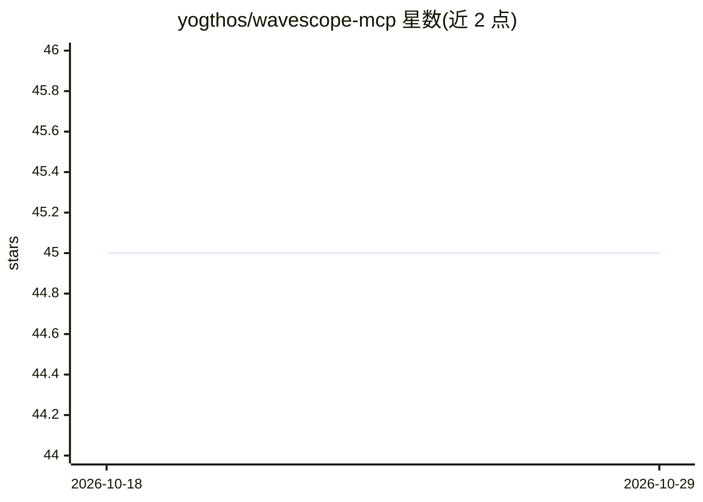

# yogthos/wavescope-mcp

⭐ 45 · TypeScript · 推送 2026-09-02 · [GitHub](https://github.com/yogthos/wavescope-mcp) · 个人维护

**MCP 服务器：用小波变换为 LLM 提供代码多分辨率上下文**

通过 Model Context Protocol 向 LLM 提供代码文件的可缩放视图：对每行代码按声明关键词打结构重要性分，经 Ricker 小波 8 尺度卷积提取结构边界，输出 fine/medium/coarse 三档摘要带，模型可先看高层结构再下钻局部，无需加载整个文件。提供 13 个工具，覆盖查询、git 版本间结构 diff、光标位置预计算、流式项目级索引、熵带与复杂度热图分析。支持 Python/TS/Go/Rust/Lisp 等十余种语言，npm 安装，面向接入 MCP 的 AI 编码助手开发者。

## 筛选速览

| 维度 | 判定 | 备注 |
|---|---|---|
| AI 角色 | `ai-ecosystem` | LLM/agent 周边工具 |
| 许可风险 | `none` | — |
| 部署形态 | `library` | 以包/库形式分发 |
| 模型依赖 | — | README 未给出锁定关系 |
| 硬件要求 | — | 无带数字的原话,不猜 |
| 安装摩擦 | `low` | 无编译、无系统依赖或容器化 |
| 成熟度 | — | 结构信号不足 |

## 能力要点

- Ricker 小波 8 尺度变换提取代码结构边界，输出三档缩放带
- diff_wavelet_context 比较 git 两个版本间的结构峰值变化
- get_entropy_bands / get_complexity_heatmap 基于编码比特成本度量局部复杂度
- 流式项目级索引，遵守 .gitignore、跳过 2MB 以上与二进制文件

## 适用场景

- 让 AI 编码助手在不加载整个文件的情况下浏览大文件结构
- 审查代码变更时定位新增/移除/位移的结构边界
- 按结构复杂度分配上下文预算、确定评审优先区域

## 场景标签

 · 领域:LLM 工具/代码分析

## 证据(README 行号)

> L4: Wavelet-based multi-resolution context management for LLMs via MCP.
> L6: Provides a **zoomable view** of code files — the model can look at high-level
> L59: ### Running as MCP server

## 星数曲线

2026-10-18 45 → 2026-10-29 45（+0）

---
*卡片 v1 · prompt 1.4 · 生成 2026-10-25 · 置信度 high · 依据 README sha `3aed90228c31` · [字段定义](../../DATASET.md)*
