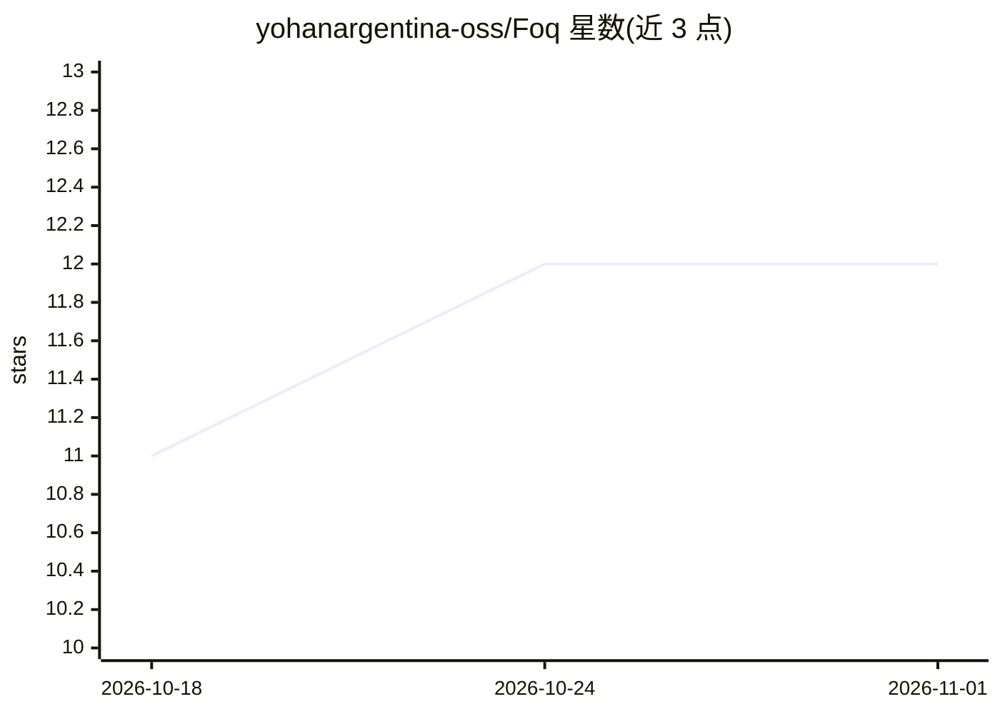

# yohanargentina-oss/Foq

⭐ 12 · Python · MIT · 推送 2026-10-18 · [GitHub](https://github.com/yohanargentina-oss/Foq) · [官网](https://foq.fr) · 组织维护

**本地开源决策引擎：把文本一次前向转为类型化决策**

面向 AI agent 的本地决策引擎：将文本经单次前向传播输出类型化决策（布尔、选项、评分、经校验的 Pydantic 对象），低置信度时标记 needs_review 而非猜测，并带 fail-closed 输入安全审计。默认基于 Foq 8B（Qwen3 架构三值权重，PQ2_0 格式）加 LoRA 决策适配器，运行于带 PQ2_0 内核的 llama.cpp 分支（官方构建无法加载该权重），需下载 2.2GB 参考权重。pip 安装，提供 CLI（setup/serve/demo/benchmark）。评测集为生成的 2500 例，非真实流量。

## 筛选速览

| 维度 | 判定 | 备注 |
|---|---|---|
| AI 角色 | `ai-native` | 本体是模型或模型工具 |
| 许可风险 | `permissive` | MIT |
| 部署形态 | `library` | 以包/库形式分发 |
| 模型依赖 | local-ok | 支持本地模型 |
| 硬件要求 | — | 无带数字的原话,不猜 |
| 安装摩擦 | `low` | 无编译、无系统依赖或容器化 |
| 成熟度 | — | 结构信号不足 |

## 能力要点

- 单次前向输出类型化决策，不生成散文
- 置信度低于阈值时标记 needs_review 而非返回猜测
- 温度缩放校准，校验集与考试集分离
- fail-closed 安全守卫在决策前审计输入

## 适用场景

- agent 流程中替代人工/云 API 做路由、情感、安全等结构化判定
- 对不确定输入自动降级转人工或二级模型复核
- 离线/内网环境下无 API 依赖地获取类型化决策

## 场景标签

 · 领域:LLM/agent 基础设施

## 证据(README 行号)

> L3: **A free, open-source, local decision engine for AI agents.** Foq turns a text
> L4: into a typed decision (a boolean, a choice, a score, a validated Pydantic
> L150: - **One forward pass per decision**: Foq reads the context once and scores the

## 星数曲线

2026-10-18 11 → 2026-11-01 12（+1）

---
*卡片 v1 · prompt 1.4 · 生成 2026-10-31 · 置信度 high · 依据 README sha `d2bded8a8d23` · [字段定义](../../DATASET.md)*
