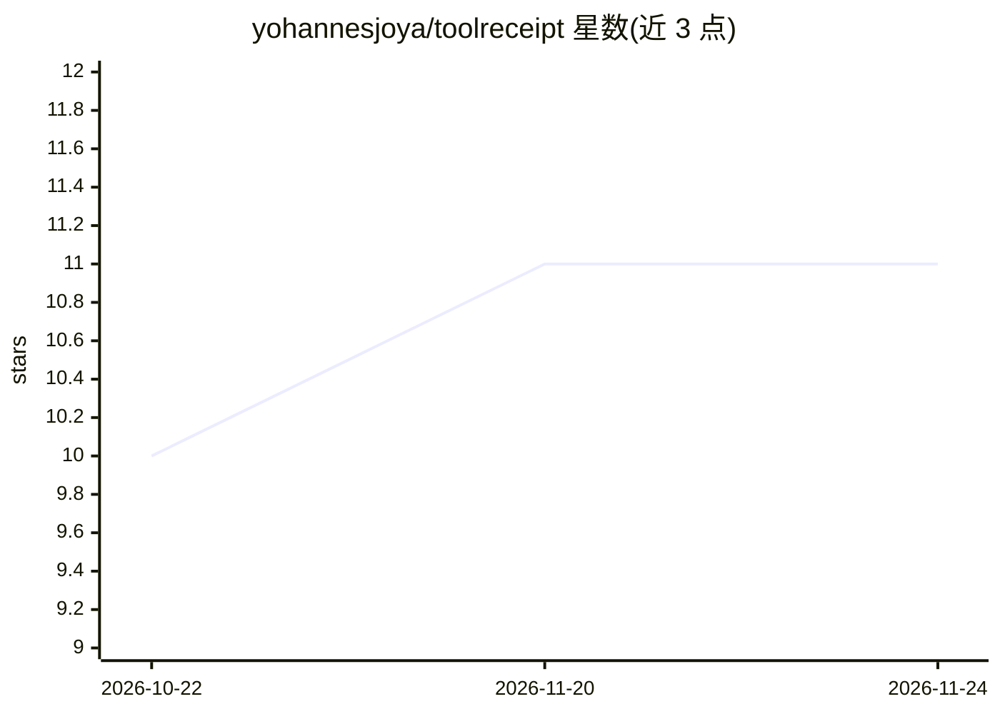

# yohannesjoya/toolreceipt

⭐ 11 · TypeScript · MIT · 推送 2026-11-15 · [GitHub](https://github.com/yohannesjoya/toolreceipt) · [官网](https://toolreceipt-demo.onrender.com) · 个人维护

**为 LangGraph agent 核验工具调用声明的审计库**

在 agent 运行期间记录工具调用台账（ledger），从最终回复中抽取动作声明，比对两者后生成 receipt，可据此拦截、标注或记录回复。核心为确定性规则匹配，无 API key、无额外模型调用、仅依赖标准库；可选 LLMExtractor 支持多语言与弱匹配场景。支持 LangGraph 集成、逐轮检查（check_turns）与返回前拦截 guard，提供 Python 3.10+ 与 TypeScript 双版本。对工具返回错误字符串、名称/日期参数、非英语默认抽取等场景不做判定。

## 筛选速览

| 维度 | 判定 | 备注 |
|---|---|---|
| AI 角色 | `ai-ecosystem` | LLM/agent 周边工具 |
| 许可风险 | `permissive` | MIT |
| 部署形态 | `library` | 以包/库形式分发 |
| 模型依赖 | — | README 未给出锁定关系 |
| 硬件要求 | — | 无带数字的原话,不猜 |
| 安装摩擦 | `low` | 无编译、无系统依赖或容器化 |
| 成熟度 | — | 结构信号不足 |

## 能力要点

- 运行时自动捕获工具调用台账，与回复声明做 diff 生成 receipt
- 核心确定性、规则驱动，无 API key 与额外模型调用，仅依赖标准库
- 覆盖 claimed_but_never_ran（not_called/tool_failed/args_mismatch）与 ran_but_unreported 等判定类型
- check_turns 支持对已结束对话逐轮出具 receipt，包括中途挂断的对话

## 适用场景

- 上线客服 agent 时拦截声称已执行但工具失败的回复
- 回放历史对话逐轮核查声明是否被工具调用支持
- 为 agent 输出加 guard，返回前核验并让 agent 修正声明

## 场景标签

`模型评测` `LLM 可观测性` · 领域:评测与运维

## 证据(README 行号)

> L3: Catch LLM agents claiming actions they never took. `toolreceipt` records every tool call
> L100: - It runs at runtime, on the live reply, and captures the ledger automatically.
> L159: pip install "toolreceipt[langgraph]"

## 星数曲线

2026-10-22 10 → 2026-11-24 11（+1）

---
*卡片 v1 · prompt 1.4 · 生成 2026-11-19 · 置信度 high · 依据 README sha `163e3337d200` · [字段定义](../../DATASET.md)*
