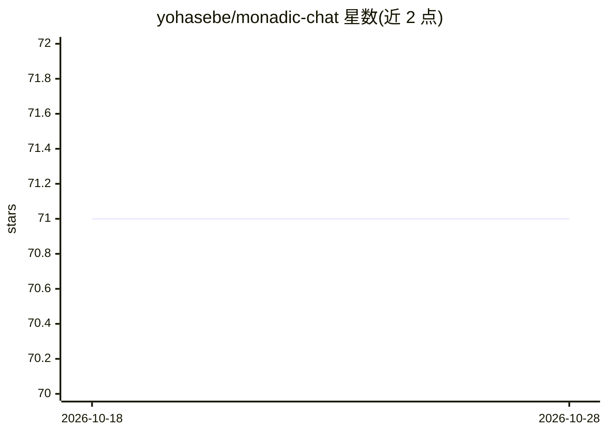

# yohasebe/monadic-chat

⭐ 71 · Ruby · Apache-2.0 · 推送 2026-10-26 · [GitHub](https://github.com/yohasebe/monadic-chat) · [官网](https://yohasebe.github.io/monadic-chat/) · 个人维护 · 中文 README

**本地托管的智能聊天机器人平台，给 LLM 提供 Docker Linux 环境**

基于 Ruby/Electron/Docker 的本地托管 Web 应用，供用户创建和使用智能聊天机器人：AI 模型接入真实 Docker 容器以运行代码、安装包、持久化文件。支持多模型服务商（OpenAI/Claude/Gemini/Mistral/Cohere/xAI/DeepSeek/Ollama）、语音交互（含连续语音对话）、图像视频生成分析、基于 Qdrant 与本地嵌入的 PDF 知识库、PII 隐私过滤与网页搜索。同时提供 Monadic DSL 作为构建自定义 AI 应用的框架。以桌面安装包分发，需先配置 API key，对话数据存储在本地。

## 筛选速览

| 维度 | 判定 | 备注 |
|---|---|---|
| AI 角色 | `ai-native` | 本体是模型或模型工具 |
| 许可风险 | `permissive` | Apache-2.0 |
| 部署形态 | `desktop` | 安装包/桌面程序 |
| 模型依赖 | local-ok | 支持本地模型 |
| 硬件要求 | — | 无带数字的原话,不猜 |
| 安装摩擦 | `low` | 无编译、无系统依赖或容器化 |
| 成熟度 | — | 结构信号不足 |

## 能力要点

- 多服务商接入（OpenAI/Claude/Gemini/Mistral/Cohere/xAI/DeepSeek/Ollama）
- Docker 容器内真实 Linux 环境执行代码与文件持久化
- Qdrant + 本地嵌入的 PDF 知识库，无需 API key
- Monadic DSL 与 MCP Server（JSON-RPC 2.0）扩展自定义应用

## 适用场景

- 本地运行多模型聊天机器人并保持数据私有
- 让 AI 在真实 Linux 容器中运行代码、做研究或处理文档
- 用 DSL 和 Docker 构建自己的 AI 应用

## 场景标签

`聊天机器人` `文档问答` · 领域:对话与助手

## 证据(README 行号)

> L17: **Monadic Chat** is a locally hosted web application for creating and utilizing intelligent chatbots. By providing 
> L63: 3. **Extensible Platform**: Not just a chatbot—a framework for building custom AI applications with Monadic DSL.

## 星数曲线

2026-10-18 71 → 2026-10-28 71（+0）

---
*卡片 v1 · prompt 1.4 · 生成 2026-10-24 · 置信度 high · 依据 README sha `8adeec5e881a` · [字段定义](../../DATASET.md)*
