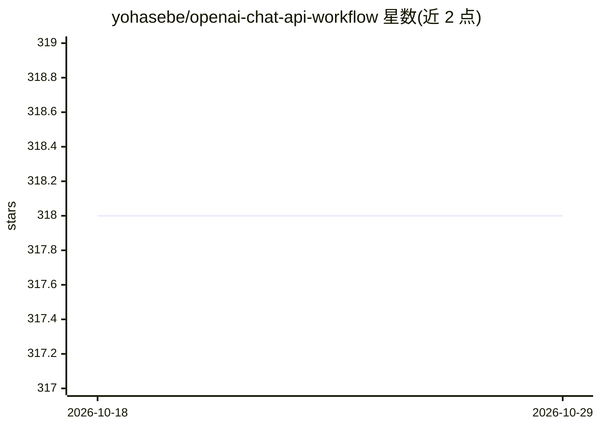

# yohasebe/openai-chat-api-workflow

⭐ 318 · Ruby · MIT · 推送 2026-10-23 · [GitHub](https://github.com/yohasebe/openai-chat-api-workflow) · [官网](https://github.com/yohasebe/openai-text-completion-workflow) · 个人维护

**macOS Alfred 启动器的 GPT 对话/图像/语音工作流**

Alfred 5 Powerpack 的付费扩展工作流，通过 OpenAI API 提供 GPT 对话、文件理解（图像/PDF/Office/代码）、图像生成与编辑、语音转文字、文字转语音。可通过 Alfred UI、选中文本或本地运行的 Web UI 三种方式调用，API 调用直接从工作流发往 OpenAI。支持对话 JSON 导出/导入续聊、API key 存入 1Password/钥匙串引用。除 SoX（终端录音需要）外无需外部工具。需要用户自备 OpenAI API key。

## 筛选速览

| 维度 | 判定 | 备注 |
|---|---|---|
| AI 角色 | `ai-native` | 本体是模型或模型工具 |
| 许可风险 | `permissive` | MIT |
| 部署形态 | `None` |  |
| 模型依赖 | — | README 未给出锁定关系 |
| 硬件要求 | — | 无带数字的原话,不猜 |
| 安装摩擦 | `low` | 无编译、无系统依赖或容器化 |
| 成熟度 | — | 结构信号不足 |

## 能力要点

- GPT 对话、文件理解、图像生成/编辑、语音转写与 TTS 多合一
- 本地 Web UI 运行，消息默认不经过第三方（仅发往 OpenAI）
- 对话 JSON 导出/导入续聊，API key 支持 1Password/钥匙串引用
- 除 SoX（可选功能）外无外部依赖

## 适用场景

- 在 Mac 上随时通过 Alfred 快捷键向 GPT 提问或处理选中文本
- 用 GPT 生成/编辑图像、理解截图内容
- 将语音转文字或将选中文本合成语音

## 场景标签

`聊天机器人` `图像生成` `语音合成` `语音识别` · 领域:对话与助手

## 证据(README 行号)

> L3: 🎩 An Alfred 5 Workflow for using the OpenAI Chat API to interact with GPT models 🤖💬. It also allows file understandi
> L9: - Alfred UI 🖥️

## 星数曲线

2026-10-18 318 → 2026-10-29 318（+0）

---
*卡片 v1 · prompt 1.4 · 生成 2026-10-21 · 置信度 high · 依据 README sha `2f8051aad3f9` · [字段定义](../../DATASET.md)*
