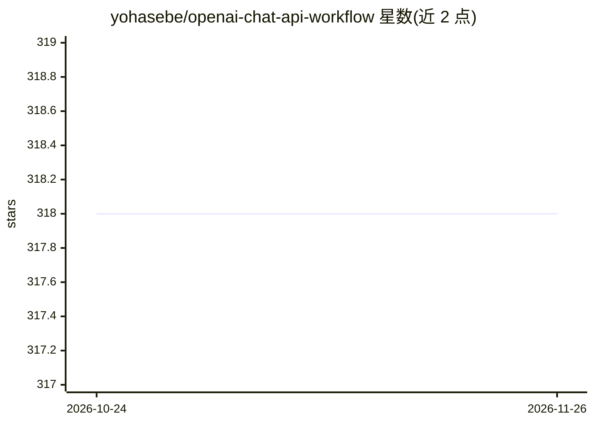

# yohasebe/openai-chat-api-workflow

⭐ 318 · Ruby · MIT · 推送 2026-10-23 · [GitHub](https://github.com/yohasebe/openai-chat-api-workflow) · [官网](https://github.com/yohasebe/openai-text-completion-workflow) · 个人维护

**macOS Alfred 用户调用 OpenAI API 的聊天/图像/语音工作流**

面向 Alfred 5 的 OpenAI Chat API 工作流，提供 GPT 对话、文件理解（图像/PDF/Office/代码）、图像生成与编辑、语音转文字、文字转语音等功能。可通过 Alfred UI、选中文本或本地运行的 Web UI 三种方式使用，支持热键配置、会话 JSON 导出导入、流式输出与缓存管理。依赖 Alfred 5 Powerpack 与 OpenAI API key；除终端录音需 SoX 外无其他外部依赖。

## 筛选速览

| 维度 | 判定 | 备注 |
|---|---|---|
| AI 角色 | `ai-native` | 本体是模型或模型工具 |
| 许可风险 | `permissive` | MIT |
| 部署形态 | `None` |  |
| 模型依赖 | — | README 未给出锁定关系 |
| 硬件要求 | — | 无带数字的原话,不猜 |
| 安装摩擦 | `low` | 无编译、无系统依赖或容器化 |
| 成熟度 | — | 结构信号不足 |

## 能力要点

- 三种执行方式：Alfred UI 命令、选中文本、本地 Web UI
- 文件理解支持图像、PDF、Office 文档与代码（OpenAI Files API）
- 会话导出为 JSON 并可导入续聊
- 支持 1Password/keychain 引用管理 API key

## 适用场景

- 在 macOS 上通过 Alfred 快速向 GPT 提问并保留对话上下文
- 用热键把选中文字直接发给模型处理
- 截屏后进行图像编辑或图像理解
- 本地 Web UI 里进行语音输入和语音合成

## 场景标签

`聊天机器人` `图像生成` `语音合成` `语音识别` · 领域:对话与助手

## 证据(README 行号)

> L3: 🎩 An Alfred 5 Workflow for using the OpenAI Chat API to interact with GPT models 🤖💬. It also allows file understandi
> L9: - Alfred UI 🖥️
> L39: - Alfred 5 Powerpack

## 星数曲线

2026-10-24 318 → 2026-11-26 318（+0）

---
*卡片 v1 · prompt 1.4 · 生成 2026-11-25 · 置信度 high · 依据 README sha `2c3a4cc07e92` · [字段定义](../../DATASET.md)*
