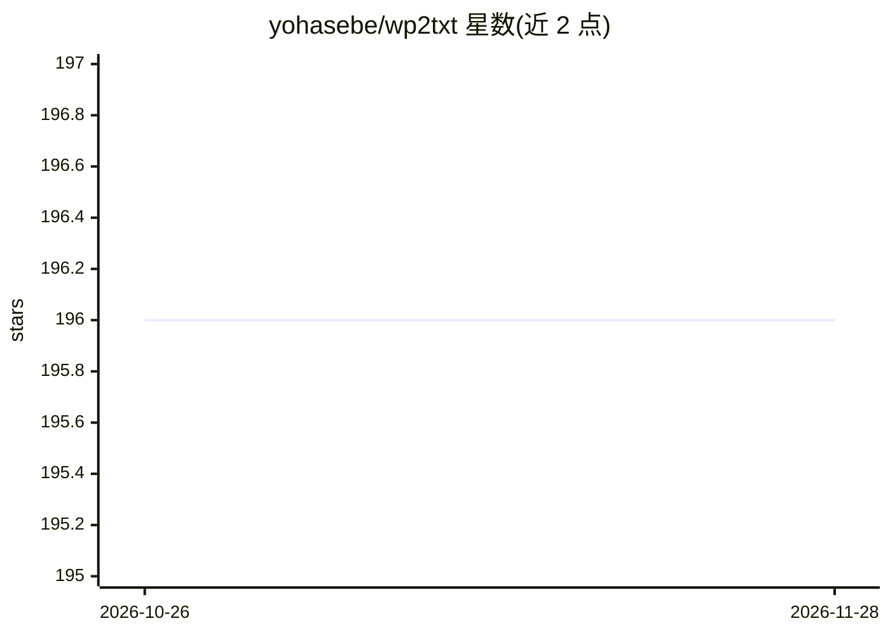

# yohasebe/wp2txt

⭐ 196 · Ruby · MIT · 推送 2026-11-27 · [GitHub](https://github.com/yohasebe/wp2txt) · 个人维护

**从 Wikipedia dump 提取纯文本与分类数据的命令行语料工具**

WP2TXT 读取 bzip2 压缩的 Wikipedia XML dump，去除 MediaWiki 标记，输出带分类元数据的纯文本或 JSONL，面向语料语言学、文本挖掘等研究用途。支持按语言代码自动下载 dump、按标题或分类抽取条目、模板展开、流式处理、离线索引与跨语言链接查询，并可启动 MCP server 将本地 dump 暴露给 LLM agent。依赖 bzip2 解压命令，提供 Ruby gem 与 Docker 两种分发方式。

## 筛选速览

| 维度 | 判定 | 备注 |
|---|---|---|
| AI 角色 | `ai-knowledge` | 知识聚合/清单类 |
| 许可风险 | `permissive` | MIT |
| 部署形态 | `self-host` | docker 或自建部署 |
| 模型依赖 | — | README 未给出锁定关系 |
| 硬件要求 | — | 无带数字的原话,不猜 |
| 安装摩擦 | `low` | 无编译、无系统依赖或容器化 |
| 成熟度 | — | 结构信号不足 |

## 能力要点

- 按标题/分类/章节过滤抽取条目，支持 350+ 语言版本的分类与重定向检测
- JSONL 输出含 page_id/revision_id，可回溯到具体文章版本
- 离线版本锁定索引，支持对某一版本 Wikipedia 的穷举式查询
- MCP server 将本地 dump 提供给 LLM agent 做可复现的语料工作

## 适用场景

- 按分类构建领域语料库，如提取全部电影条目的情节章节
- 为 NLP 任务抽取带元数据的 Wikipedia 文本
- 构建版本锁定的 RAG 知识库与 LLM 评测数据集
- 通过 MCP 让 agent 基于本地 dump 做有出处的语料查询

## 场景标签

`文档解析` · 领域:知识与检索

## 证据(README 行号)

> L16: WP2TXT extracts plain text and category information from Wikipedia dump files. It processes XML dumps (compressed w
> L29: - **MCP server** - Expose a local dump to LLM agents (Claude, ChatGPT, Gemini, local models) for grounded, reproduc
> L39: - Version-pinned RAG knowledge bases and LLM evaluation datasets

## 星数曲线

2026-10-26 196 → 2026-11-28 196（+0）

---
*卡片 v1 · prompt 1.4 · 生成 2026-11-28 · 置信度 high · 依据 README sha `eaf48cef5209` · [字段定义](../../DATASET.md)*
