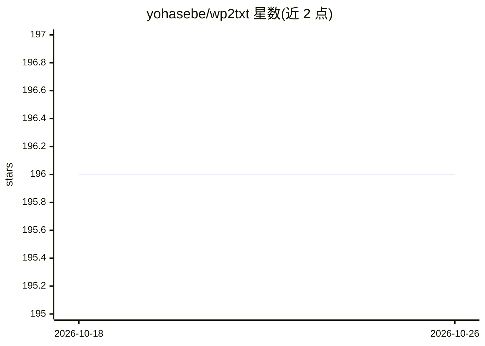

# yohasebe/wp2txt

⭐ 196 · Ruby · MIT · 推送 2026-10-03 · [GitHub](https://github.com/yohasebe/wp2txt) · 个人维护 · 中文 README

**从 Wikipedia dump 提取纯文本与分类数据的命令行工具**

Ruby 编写的 CLI 工具：读取 bz2 压缩的 Wikipedia XML dump，去除 MediaWiki 标记，输出适合语料库语言学与文本挖掘的纯文本或 JSONL，并保留 page_id/revision_id 等元数据。支持按语言码自动下载、按标题或分类抽取文章、350+ 语言的分类与重定向检测、模板展开、引用抽取，以及基于 SQLite 的离线索引与全文查询。另含 MCP 服务器，可将本地 dump 以版本固定方式暴露给 LLM agent。面向语料/NLP 研究者与数据工程师。

## 筛选速览

| 维度 | 判定 | 备注 |
|---|---|---|
| AI 角色 | `ai-enhanced` | 去掉 AI 部分产品仍成立 |
| 许可风险 | `permissive` | MIT |
| 部署形态 | `self-host` | docker 或自建部署 |
| 模型依赖 | — | README 未给出锁定关系 |
| 硬件要求 | — | 无带数字的原话,不猜 |
| 安装摩擦 | `low` | 无编译、无系统依赖或容器化 |
| 成熟度 | `idea` | |

## 能力要点

- 按标题或分类抽取文章，无需处理全量 dump
- JSONL 输出含 page_id/revision_id，可回溯文章版本
- SQLite 离线索引：分类/章节/全文/跨语言链接查询
- MCP 服务器将本地 dump 暴露给 LLM agent，结果可复现

## 适用场景

- 构建领域语料库，如抽取所有电影条目的剧情章节
- 生成版本固定的 RAG 知识库或 LLM 评测数据集
- 对某 Wikipedia 版本做穷尽式断言（某分类中无文章提及 X）
- 跨语言比较研究（利用平行分类结构与跨语言链接）

## 场景标签

 · 领域:NLP/语料工具

## 证据(README 行号)

> L16: WP2TXT extracts plain text and category information from Wikipedia dump files. It processes XML dumps (compressed w
> L29: - **MCP server** - Expose a local dump to LLM agents (Claude, ChatGPT, Gemini, local models) for grounded, reproduc
> L293: Beyond text extraction, wp2txt can turn a dump into a **local, version-pinned database**:

## 星数曲线

2026-10-18 196 → 2026-10-26 196（+0）

---
*卡片 v1 · prompt 1.4 · 生成 2026-10-22 · 置信度 high · 依据 README sha `8f4b6d74bf54` · [字段定义](../../DATASET.md)*
