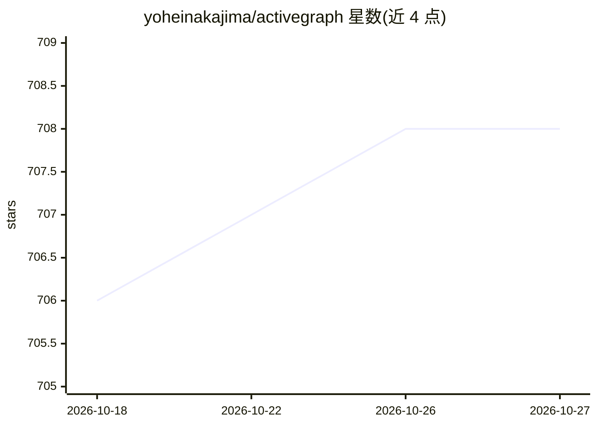

# yoheinakajima/activegraph

⭐ 708 · Python · Apache-2.0 · 推送 2026-09-26 · [GitHub](https://github.com/yoheinakajima/activegraph) · [官网](https://activegraph.ai) · 个人维护

**事件溯源图运行时：为长时运行、可审计的 agent 提供框架**

Python 编写的反应式图运行时与 agent 构建框架：以对象+类型化关系构成共享图，所有变更记入 append-only 事件日志；行为（函数/类/LLM 支撑/关系行为）订阅事件并产出事件，支持 fork-and-diff 分支对比、重放、策略审批与事件导出。以 pack 组织领域本体，内置 Diligence 参考 pack 可无 API key 运行于录制 fixtures。pip 安装，Python 3.11+，核心仅两个硬依赖，LLM provider 集成为可选 extras（Anthropic/OpenAI 同一 Protocol 接口）。

## 筛选速览

| 维度 | 判定 | 备注 |
|---|---|---|
| AI 角色 | `ai-ecosystem` | LLM/agent 周边工具 |
| 许可风险 | `permissive` | Apache-2.0 |
| 部署形态 | `library` | 以包/库形式分发 |
| 模型依赖 | locked-api |  |
| 硬件要求 | — | 无带数字的原话,不猜 |
| 安装摩擦 | `low` | 无编译、无系统依赖或容器化 |
| 成熟度 | — | 结构信号不足 |

## 能力要点

- append-only 事件日志，每次运行可恢复、可 fork、可 diff
- 关系行为原语：协调逻辑挂在类型化边上而非端点
- fork-and-diff 借助 LLM 重放缓存使共享前缀不重执行
- pack 机制打包对象类型、行为、工具、提示词与策略

## 适用场景

- 构建需要完整审计轨迹的长时运行 agent 系统
- 对 agent 运行做分支实验并结构化对比结果
- 按领域组织本体与行为，搭多 pack 无中心编排的助手

## 场景标签

`Agent 框架` · 领域:Agent 开发

## 证据(README 行号)

> L11: An event-sourced reactive graph runtime for long-running, auditable,
> L93: - **Reactive behaviors as first-class.** Function, class, LLM-backed,

## 星数曲线

2026-10-18 706 → 2026-10-27 708（+2）

---
*卡片 v1 · prompt 1.4 · 生成 2026-10-21 · 置信度 high · 依据 README sha `42fd7977cb01` · [字段定义](../../DATASET.md)*
