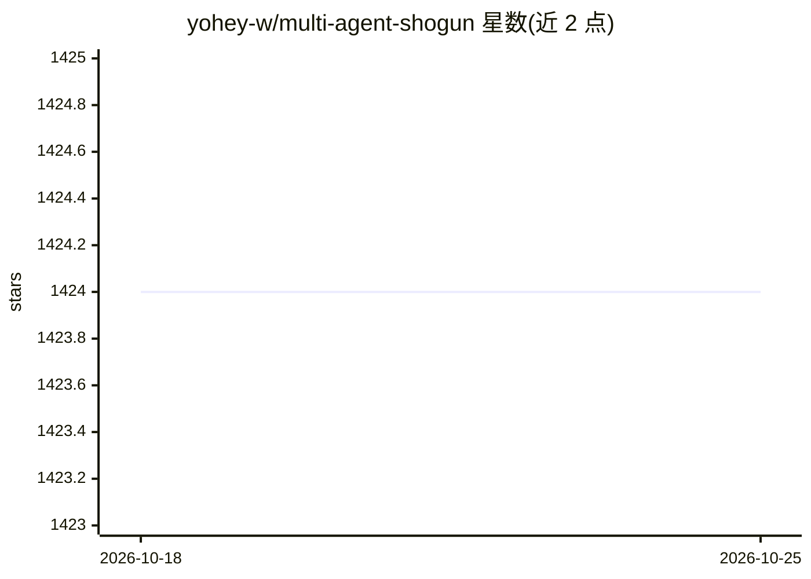

# yohey-w/multi-agent-shogun

⭐ 1,424 · Shell · MIT · 推送 2026-08-06 · [GitHub](https://github.com/yohey-w/multi-agent-shogun) · 个人维护

**用 tmux 并行编排 7 种 AI 编码 CLI 的多 agent 系统**

基于 tmux 与 YAML 文件的将军→家老→足轻层级多 agent 编排系统：一条命令生成 7 个并行工作 agent + 1 个军师，通过磁盘上的 YAML 文件做事件驱动通信，编排过程不消耗额外 API 调用。支持 Claude Code、OpenAI Codex、GitHub Copilot、Kimi Code、OpenCode、Cursor、Antigravity 七种 CLI 作为 agent 运行时，角色边界嵌入各 CLI 的指令文件。提供 Windows(WSL2) 安装脚本、Android 手机监控 App(APK) 与 ntfy 通知。要求 tmux、bash 4+ 与至少一种受支持 CLI。作者声明后续转向单 agent 项目 kagemusha，本项目仍按原样可用。

## 筛选速览

| 维度 | 判定 | 备注 |
|---|---|---|
| AI 角色 | `ai-ecosystem` | LLM/agent 周边工具 |
| 许可风险 | `permissive` | MIT |
| 部署形态 | `library` | 以包/库形式分发 |
| 模型依赖 | locked-api |  |
| 硬件要求 | — | 无带数字的原话,不猜 |
| 安装摩擦 | `low` | 无编译、无系统依赖或容器化 |
| 成熟度 | — | 结构信号不足 |

## 能力要点

- tmux 面板中并行运行 8 个独立 agent，YAML 文件磁盘通信实现零编排开销
- 支持 7 种 AI 编码 CLI 并可混用，统一指令模板按 CLI 生成
- 足轻自下而上自动提出可复用技能候选，由用户决定晋升
- Android 伴侣 App 提供 SSH 终端、语音输入与 9 面板监控

## 适用场景

- 让多个 AI 编码 CLI 并行分担编码任务并实时监控进度
- 在 Claude Max 等包月订阅下低成本并行运行多 agent
- 用手机远程指挥和查看在 WSL2/服务器上运行的 agent 军团

## 场景标签

`多智能体` `编码 Agent` · 领域:Agent 开发

## 证据(README 行号)

> L5: Run 10 AI coding agents in parallel — **Claude Code, OpenAI Codex, GitHub Copilot, Kimi Code, OpenCode, Cursor, Anti
> L51: **multi-agent-shogun** is a system that runs multiple AI coding CLI instances simultaneously, orchestrating them li
> L68: Most multi-agent frameworks burn API tokens on coordination. Shogun doesn't.

## 星数曲线

2026-10-18 1,424 → 2026-10-25 1,424（+0）

---
*卡片 v1 · prompt 1.4 · 生成 2026-10-21 · 置信度 mid · 依据 README sha `0ceaca8d3a81` · [字段定义](../../DATASET.md)*
